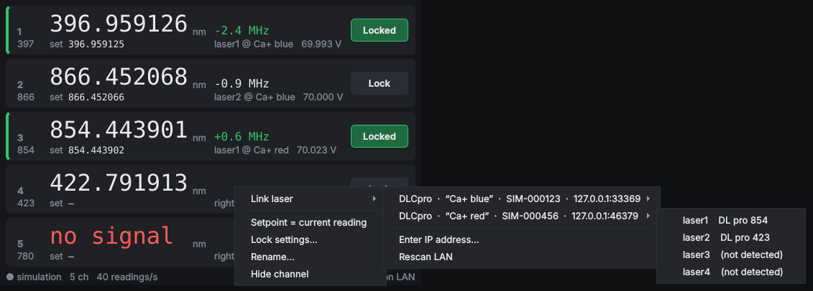
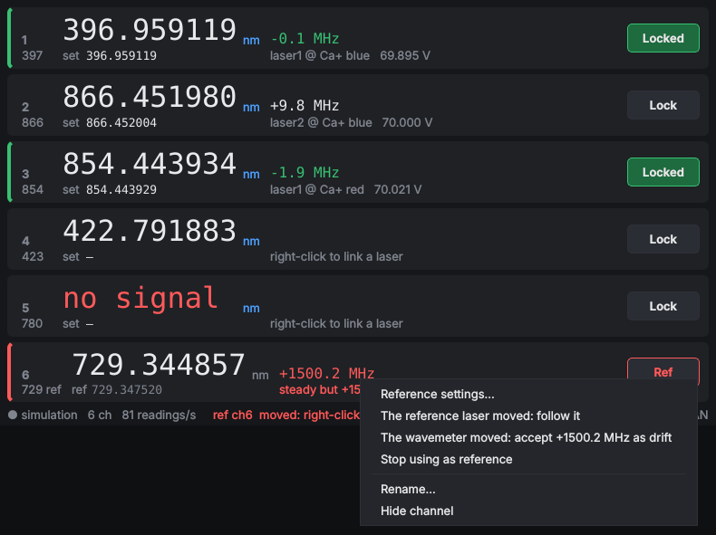
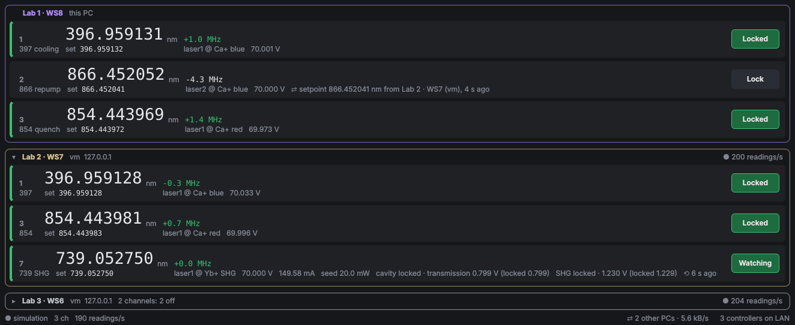
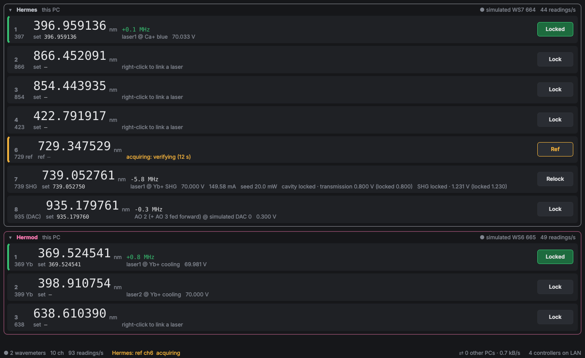
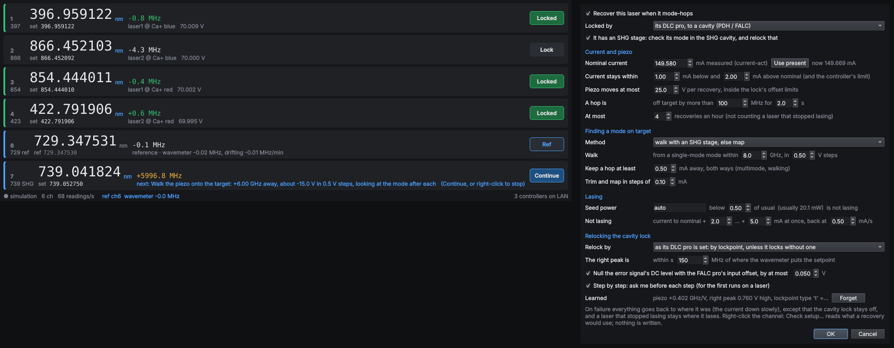
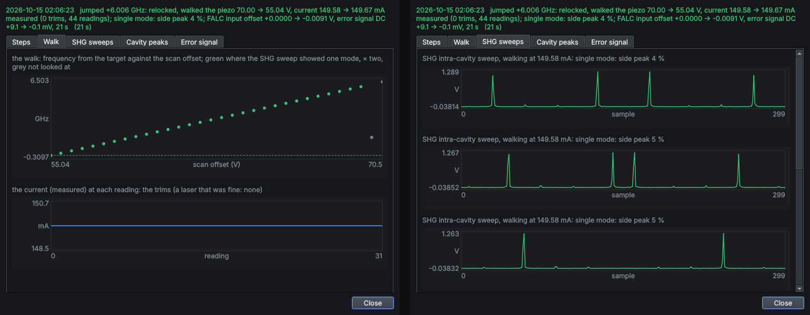
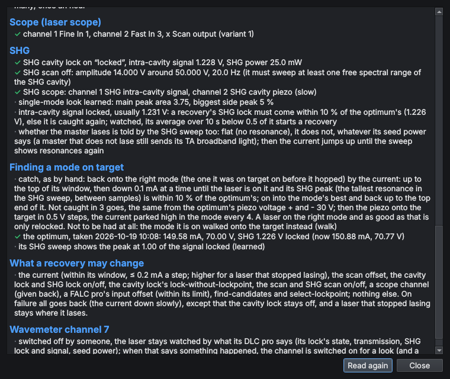
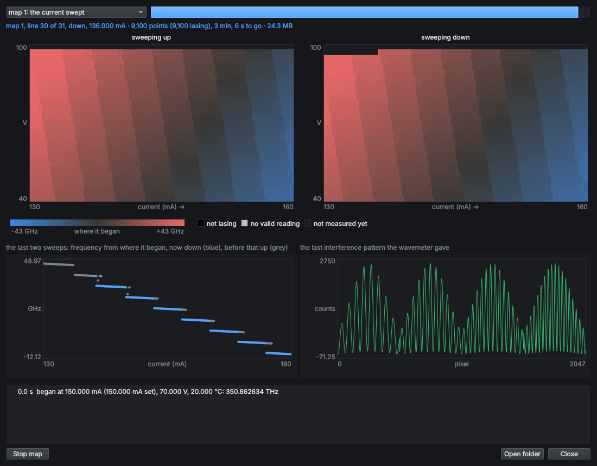

# SimpleWavemeterLock

A small, fast GUI to lock TOPTICA DL pro lasers (DLC pro controllers) to a
HighFinesse wavemeter. It replaces WAND for day-to-day locking: one window,
one row per active wavemeter channel, right-click to pick a laser, click to lock.



* **Active channels only**, each with its **vacuum wavelength to 9 significant
  digits** (computed from the measured frequency, so it does not depend on the
  air/vacuum setting of the WLM software), the deviation from the setpoint in MHz
  and the laser's scan offset.
* **Right-click a channel → Link laser** lists every DLC pro on the LAN (found the
  way TOPAS finds them, by UDP broadcast) with its serial number, system label
  and the lasers it drives (`laser1` … `laser4`). Pick one. **Enter IP
  address…** is there for controllers on another subnet.
* **Lock** runs a simple PI loop that only touches `laserN:scan:offset`. For a laser its
  DLC pro locks to a cavity, the button is **Relock** instead: it never touches the piezo, it
  watches the laser and relocks it after a mode hop, when it is locked on the wrong cavity peak,
  or when its lock keeps losing it.
* **Reference laser** (optional): a laser locked to a stable cavity corrects the
  wavemeter's drift for every other channel, and is ignored automatically while it
  mode-hops, unlocks or loses light.
* **Mode-hop recovery** (optional): after a mode hop, the laser is put back on its
  target on a mode that holds, by moving its diode current as well as its piezo, within
  a current window you set, and handed back to its lock: this program's wavemeter lock,
  or the DLC pro's own cavity lock (PDH / FALC), relocked by lockpoint on the right peak
  as you would by hand. For an SHG laser, as by hand: back onto its own mode by the current
  (up, then down a step at a time until its SHG peak is within 10 % of the optimum you set up by
  hand; failing that, from the optimum's piezo voltage ± 30 V), then the piezo walked onto the
  target, the current kept high in the mode on the way; the SHG cavity is relocked too. With a
  TA, its seed power shows whether the laser lases: if it stops, its current is jumped up at once
  and brought back down slowly.
* **Lasers without a digital controller**: their piezo driver on an analog output (a DAC), as the
  LabVIEW program Epimetheus drove them, on its Measurement Computing board (see *Lasers on an
  analog output*).
* **Several PCs** (optional, on by default): every copy of the program on the LAN finds the
  others by itself. Each window shows every wavemeter, framed under its name, and the other
  PCs' lasers can be adjusted from it (setpoint, Lock, Relock, Continue…), by the PC they
  belong to. A few kB/s, UDP (see *Several PCs*).
* **The WLM software restarted when it gets stuck** (on by default): an exception of its own and its
  readings freeze, or it closes by itself: closed (killed if it hangs), started again, measuring
  again, by itself (see *When the WLM software gets stuck*).
* **Calls from other programs** (sipyco's, as ARTIQ makes them; on by default): every copy of the
  program answers them for every laser on every PC, from any Python program (`sipyco.pc_rpc.Client`)
  or ARTIQ experiment: setpoints (to the digit), Lock, readings, *are these lasers okay?*, and their
  lock dropouts over a stretch of time. No server of its own (see *ARTIQ*).
* **SLS lock electronics** (Stable Laser Systems' Laser Servos and PLLs, on the LAN): a laser one of them locks is
  watched, its lock's dropouts logged; a slave a PLL's manual lock beat-locks to a master is **guarded**: its PLL
  released the moment the master's lock or the beat is lost (before it runs the slave's current away and the slave
  stops lasing, its TA switching itself off), the slave recovered if it stopped, and its PLL engaged again on the beat
  once the master holds. Its master may be read by another wavemeter, on another PC: picked from what the network
  shows, and followed from there (see *SLS locks*).
* **Several wavemeters on one PC**: one copy of the program reads them all, each framed under its
  own name with its own channels, lasers and settings, told apart by their serial numbers (see
  *Several wavemeters on one PC*).
* **Laser maps**: a laser's current and piezo (and its temperature, if asked) swept over all the
  ground you give them, both ways, its feedforward off (a square in the current as measured), with
  everything the wavemeter says at every point (its frequency, power, exposure, and its interference
  patterns: the spectrum, where a second mode shows) and what the DLC pro measures, kept in a file to look
  at the laser afterwards and to model it (the model's physics: [docs/laser_model.md](docs/laser_model.md));
  the ideal feedforward fitted from where it hops, and set if you like (see *Laser maps*).
* Fast by construction: the wavemeter is read in its own thread, all network I/O
  happens in one worker thread per controller (writes are coalesced, Nagle off),
  and the GUI only repaints numbers that changed. Nothing ever blocks the window.

## Install

Python ≥ 3.8 and one Qt binding (PySide6 preferred; PyQt5 and PyQt6 also work):

```
pip install PySide6 ifaddr numpy scipy numba
```

(or `pip install -r requirements.txt`). numpy, scipy and numba are for the laser's model, fitted to its maps
(*Laser maps*): the rest runs without them. numba compiles its inner loops, ten times as fast; without it the
model is fitted all the same, in numpy.

For lasers on an analog output board (*Lasers on an analog output*), also `pip install mcculw`, with
MCC's InstaCal installed (Windows).

`ifaddr` is optional. It is used to broadcast on every network adapter; without it
discovery uses 255.255.255.255 only.

## Run

```
python -m wmlock                 # on the wavemeter PC: reads wlmData.dll directly (fastest)
python -m wmlock --http http://wavemeter-pc:8000   # anywhere else, via server/server.py
python -m wmlock --sim           # demo: two simulated wavemeters, fake DLC pros, a reference laser
python -m wmlock --view          # no wavemeter on this PC: the other PCs' only (see Several PCs)
```

The source you choose is remembered, so afterwards plain `python -m wmlock` or
double-clicking `wmlock.pyw` (Windows, no console window) is enough. Started from a console
(PowerShell, say), warnings go there with the time: unlocks, recoveries, and lock dropouts (see
*Lock dropouts*). Other options:
`--dll PATH` for a non-standard DLL location, `--channels 1,2,5` to override the
switch's channel list, `--config FILE` for a different settings file (default
`~/.simplewavemeterlock.json`), `--name NAME` for this wavemeter's name on every PC
(see *Several PCs*). One copy of the program at a time uses a settings file: started again with the
same one, it says so and closes (one copy reads every wavemeter of its PC: see *Several wavemeters on
one PC*).

The WLM software must be running, with the multichannel switch cycling over the
channels you want. It reads every channel as soon as the WLM has a new result,
and shows the channels ticked "Use" in the switch settings. It switches no
channel itself, except for one case: when someone unticks the channel of a laser it watches,
it switches that channel back on when the laser needs relocking, then off again
(see *Its wavemeter channel switched off*).

## Use

| | |
|---|---|
| Right-click a channel | Link laser ▸ controller ▸ laserN, Enter IP address…, Analog output (DAC)…, Rescan LAN, Unlink, Setpoint = current reading, Lock settings…, Mode-hop recovery… (on an analog output: Analog output…), Recenter now, Check setup…, Last recovery…, Use as reference laser, Rename…, Hide channel |
| **Lock** button | Engage or release. Without a setpoint it locks to the current reading. Green means locked; a red bar means it unlocked itself, and the reason is shown under the deviation. Amber *Recentering* means a mode-hop recovery is running: click to stop it (everything goes back). Blue *Continue*: step by step, it waits for you to allow the step shown on the row. |
| **Relock** button | For a laser its DLC pro locks to a cavity (*Mode-hop recovery… ▸ Locked by its DLC pro*), in place of Lock: this program does not lock it to the wavemeter. Click it to have the laser watched (*Watching*, green) and relocked after a mode hop, when it is locked more than 50 MHz from its target (another peak: the wavemeter is never that far off), or when its lock keeps losing it and relocking (its transmission, on average, far below its level locked); if any of that is so when you click, it is relocked there and then. Normally it does nothing at all, also while someone has its wavemeter channel switched off (see *Its wavemeter channel switched off*). Click *Watching* to stop. |
| `set` field | Setpoint as vacuum wavelength in nm. Type and press Enter, or put the cursor next to a digit and use ↑/↓ or the mouse wheel to step that digit. This works while locked, so you can walk the laser. |
| Double-click the name | Rename |
| Right-click empty space | Rescan LAN (F5), Network…, Show hidden channels, Always on top, Larger/smaller digits (Ctrl +/−); with `--sim`, Simulate a fault |
| Another PC's wavemeter | Its rows work as they do on that PC (see *Several PCs*); click its name to fold it away or back; right-click its name: Network…, Forget (once it is gone) |
| A wavemeter of this PC's, with others (see *Several wavemeters on one PC*) | Click its name to fold it away or back; right-click its name: Swap settings with…, Hide this wavemeter…, Network…; right-click empty space: Show wavemeter |

Greyed digits mean the channel has had no new reading for 3 s; a grey *off* in their place, that
someone unticked the channel in the WLM software (see *Its wavemeter channel switched off*). What a
row says under its deviation goes onto more lines when it is long: the window keeps its width.

## The lock

On every **new** reading of a channel (never on stale data), with
`e = measured − setpoint` in GHz:

```
offset = offset_at_engage − (P·e + I·Σe)
```

* Gains are per reading, so the loop behaves the same whatever the switch cycle
  time is. Defaults: P = 0, I = 0.5 V/GHz. With a tuning coefficient K
  (GHz/V), I = 1/K corrects the whole error in one reading; about 0.3/K is a
  robust choice.
* **Sign**: positive gains assume the frequency rises with the offset. Gains of the wrong sign for
  the laser push it away from the setpoint, faster and faster: for its first 100 readings, a lock
  watches for that (the error, one sign all the while, grown gradually from its smallest by 30 MHz,
  and by as much as it was then, up to 300 MHz, while the offset moved the way the gains would
  bring it back; a jump is a hop, not that). Caught at it, it goes back to where the error was
  smallest, **reverses its gains** (kept: *Lock settings…* shows them) and locks; the row says
  *gains reversed by the lock: it ran away*, its tooltip and the console how far it went. Running
  away again with its gains reversed, the laser does not follow that offset as the wavemeter sees
  it (the channel linked to the wrong laser, say): it is unlocked and put back where it was
  nearest, its gains as they were. Later on, a lock that runs off is unlocked by its limits, as
  ever. In the `--sim` demo the 866 nm laser is built the other way round, so you can watch the
  lock catch it.
* **What it moves**: the piezo, by the scan offset (`laserN:scan:offset`), where the DLC pro's
  scan generator drives the piezo, as it does on most. Where it drives something else (*Scan ›
  Output channel*: the current, say, as on our second TA-SHG pro, whose scan offset is its current,
  160 mA, its piezo at 41.3 V), the lock moves the piezo's own set value (`laserN:dl:pc:voltage-set`)
  instead, and a recovery sets the current by the scan's offset (`dl:cc:current-set` drives nothing
  there). Which it is, is read whenever the laser is locked or recovered, and watched: switched at the
  DLC pro while the laser is locked, the laser is unlocked within a second (what the lock writes would
  set something else from then on): switch it with the lock off. *Check setup…* says which it uses.
  In `--sim`, the 423 nm laser's scan drives its current.
* The lock is bumpless: it reads the present offset when you engage. Each reading
  moves the offset by at most *Max step* (0.25 V). The lock unlocks itself and
  says why if any of these happens:
  * the offset would leave *Min/Max offset* (0–140 V);
  * the offset would move more than *Max excursion* (±10 V) from where it was locked;
  * the error stays outside the *Capture range* (3 GHz, e.g. a mode hop) for 3 readings;
  * the controller stops answering.
* Invalid readings (low signal, overexposed, …) are skipped and the laser is
  left alone. Locks always start released when the program starts.
* If someone unticks the channel's "Use" in the WLM software, the lock is held where it is
  (*lock held* on its row, still shown), and goes on when the channel is ticked again.

## Lasers on an analog output

Older lasers, with a piezo driver and no DLC pro, are locked through an analog output (a DAC) that
feeds their piezo driver, as Epimetheus (the LabVIEW program) did. Right-click the channel ›
*Link laser* › *Analog output (DAC)…* and pick the board, the output and the limits. The lock then
moves that output's voltage in place of a DLC pro's scan offset. Everything else (setpoint, Lock,
reference laser, the other PCs) works as for any laser; mode-hop recovery needs a DLC pro, so it is
not offered.

* **The board**: a Measurement Computing board, as Epimetheus's: its ULx *Dev0* is board 0 in InstaCal.
  It is driven through MCC's Python library, `pip install mcculw` (Windows, with InstaCal installed
  and the board set up in it). Each output is written with the range InstaCal has for it (±10 V if
  none), and nothing else is ever written: no test pattern, no zeroing at the start.
* **A DAC cannot be read back.** What this program last wrote to each output is kept (in the
  settings), and the lock starts from there. Whenever the board is opened (at the start, or plugged in
  again; a power cut leaves it at 0 V) every output in use is set back to it. An output this program
  never wrote is not known, and it is not locked until you set it: right-click › *Analog output…*,
  type the voltage the laser sits at now (in Epimetheus: its offset plus its PID's output, the *piezo*
  it shows) and click *Set*. While the laser is not locked, the same dialog moves it by hand (↑/↓ on a
  digit, as for the setpoint).
* **Limits**: by default as in Epimetheus. The output never leaves ±1.2 V, and while locked it moves
  at most ±0.8 V from where it locked, 0.02 V a reading at most (*Lock settings…*: Min/Max offset,
  Max excursion, Max step).
* **Feed-forward** (Epimetheus's current output, `index_I`): a second output can follow the first's
  moves divided by a ratio (its *Feed_forward*), from where it was when the lock engaged. It, too, must
  be set by hand once.
* **Gains** are per reading, in V/GHz (see *The lock*), positive if the frequency rises with the
  voltage, which is what Epimetheus's Kc = −1 meant. Epimetheus's PID acted on the wavelength in nm,
  over time. Its Kc and Ti (in minutes) correspond here to P ≈ |Kc|·λ²/c and
  I ≈ |Kc|·λ²/c·Δt/(60·Ti), with λ²/c in nm/GHz (2.9·10⁻³ at 935 nm, 5.3·10⁻⁴ at 399 nm) and Δt the
  time between the channel's readings in seconds. Its Kc = −1 and Ti = 0.0005 min give, at 935 nm with
  a reading every 0.1 s, P = 0.003 and I = 0.01 V/GHz: the defaults here.
* **One program per board.** Epimetheus rewrites all 16 outputs every 4 ms: do not run it at the same
  time, nor anything else that drives the board (Atlas). MCC's library itself allows one program at a
  time: on a PC with several wavemeters, this one program drives the board for the lasers of all of
  them (see *Several wavemeters on one PC*).
* In `--sim`, channel 8 is such a laser (8 GHz/V) on a simulated board, its current fed forward on
  output 3.

Where Epimetheus kept a laser's settings (`config.ini`, a `[laser_n]` each), and where they go here:

| Epimetheus | Here |
|---|---|
| `index_P` | *Analog output (DAC)…* › Output |
| `index_I` (−1: none), its Feed_forward | › Feed its moves forward to output … divided by |
| `last_offset_P` (+ the PID's output) | *Analog output…*: the voltage now, set once |
| `last_offset_I` | *Analog output…*: the second output, set once |
| `wavelength_target` | the setpoint (`set`) |
| `wavelength_source` (`H_1`: Hermes's channel 1) | the channel the laser is on, in its wavemeter's frame (name it Hermes) |
| `P`, `I`, `D` (Kc, Ti in min, Td) | *Lock settings…* P and I (see Gains); D: none |

## Reference laser

If one of the lasers on the wavemeter is locked to a cavity that is more stable
than the wavemeter, right-click it and choose **Use as reference laser**. Its row
turns blue and shows the raw reading, where the reference should be (`ref`), and
the wavemeter's error and drift rate as measured on it. Every other channel is
then corrected for that error before display and before its lock acts; their `nm`
turns blue as a reminder, and the tooltip shows the raw reading. Locked lasers keep
a fixed relationship to the reference laser, however the wavemeter drifts, and
across restarts.



**How the correction works.** A Fizeau wavemeter's slow error is, to first order, the
same relative error ε on every channel. The reference sits at a fixed frequency F0,
so its reading F0·(1 + ε) measures ε, and each other reading f becomes f / (1 + ε).
(*Correction: the same offset for every laser* is an option in *Reference settings…*.)
F0 is wherever the reference is when you choose it, so nothing jumps. If you know the
reference laser's true wavelength (a comb, an atomic line), type it into *Reference
settings…*: every channel becomes absolutely calibrated, and locked lasers move to keep
their setpoints in that frame. The GUI asks first, and says by how much they will move.

**Why a misbehaving reference is ignored.** A reference that misbehaves jumps, sweeps,
runs away or goes dark. The wavemeter can do none of those: it only drifts, and slowly.
So:

* **Tracking.** The wavemeter's error and its rate are estimated with a critically
  damped α-β tracker (*Averaging time* 30 s). It follows real drift without lag.
* **Ignored readings.** A reading further than 6σ (at least 2 MHz) from the prediction
  is ignored. σ is the reference's own reading-to-reading scatter, which a slow
  runaway cannot inflate.
* **Hold.** Three such readings in a row, missing light, 10 s without readings, or an
  estimated rate above *Wavemeter drifts at most* (2 MHz/min) put the reference on
  **hold**. The correction is frozen there; for a slow runaway it is first wound back
  to before it started. Locks carry on with the frozen correction.
* **Resuming.** To be trusted again, the reference must produce a run of consistent
  readings. A straight-line fit over that run has to show that it is quiet and its
  slope is below the drift limit, within its own uncertainty. That takes about 10 s
  with a quiet wavemeter, longer with a noisy one. The run must also sit where the
  frozen correction expects it, give or take what the wavemeter can have drifted
  meanwhile (*drift limit × time*, at most *Largest drift over an outage*, 50 MHz). The
  difference is then taken up as wavemeter drift.
* **Moved.** If the reference comes back steady but somewhere else, e.g. on another
  cavity mode, the row turns red. The correction stays frozen until you right-click
  and decide:
  * *The reference laser moved: follow it*: nothing else moves.
  * *The wavemeter moved: accept … as drift*: locked lasers follow, and you are told
    by how much first.

Things to know:

* Set *Wavemeter drifts at most* comfortably above your wavemeter's real drift (WS7/WS8
  typically drift well under 0.5 MHz/min). Near the limit, proving "slower than the
  limit" takes long.
* A reference that unlocks but then drifts no faster than a wavemeter cannot be told
  apart from wavemeter drift by its readings alone.
* The WLM software's own auto-calibration steps the wavemeter's error. A step bigger than
  the gate shows up as *moved*: accept it as drift. Better, turn auto-calibration off,
  since the reference now does that job continuously.
* The reference's channel cannot be locked to the wavemeter; it is locked to its cavity.
* In `--sim`, channel 6 (729 nm) is a cavity-locked reference.
  *Right-click empty space ▸ Simulate a fault* gives it mode hops, a cavity unlock or a
  blocked beam, or steps the wavemeter, so you can watch all of the above happen.

## Several PCs

Run the program on each PC that has a wavemeter: they find each other on the LAN by
themselves. Each window then shows every wavemeter, framed in a colour of its own under its
name, this PC's first. Another PC's rows show what they show on that PC, live, and work as they
do there: type a setpoint (or step its digits), click Lock, Relock, Continue or Stop, right-click
for *Setpoint = current reading*, *Recenter now*, *Lock settings…* or *Rename…*. The PC the
wavemeter belongs to does it, exactly as if it had been clicked there: nothing is ever written to
a wavemeter or a laser by any other PC. Its row says so for 10 minutes (*⇄ setpoint 739.052750 nm
from Lab 2 · WS7 (LAB2-PC), 5 s ago*), and its console logs it. Linking lasers, mode-hop recovery
and the reference laser are set up on the PC itself.



* **Names.** Each wavemeter is labelled by its name, the same on every PC: until you give it
  one, its PC's name (with its model and serial number, *WS7 1234*, if the WLM says). Right-click › *Network…* › *Its
  name*, or start with `--name "Lab 2 · WS7"`. The colour of its frame comes from its name (no two
  alike), so it is the same on every screen too. With other PCs about, the window's title has this PC's.
* **Lightweight.** UDP only, and only what changed. A PC showing another's 7 channels (5 of them
  locked) gets about 2.5 kB/s from it: new readings at most 10 times a second (only those that
  changed), the rest of a row only when it changes, all of it every 5 s in case something was
  lost. Fold a wavemeter away (click its name) or minimize the window: about 0.3 kB/s. Alone on
  the LAN, a PC sends a 170-byte hello to each broadcast address every 5 s. Every datagram stays
  under 1200 bytes. The status bar shows what goes to and fro (*⇄ 2 other PCs · 5.1 kB/s*).
* **Finding each other.** By broadcast every 5 s, as the DLC pros are found (UDP port 47474,
  shared by the copies on a PC; each copy has a port of its own besides), and through the PCs
  each one knows. A PC on another subnet, which broadcasts do not reach: list it in *Network…* ›
  *Also talk to* (`lab3-pc, 10.1.2.3`): one PC listing it is enough, the others hear of it.
* **Who may adjust.** Any PC in the same *Group* (none by default: every copy on the LAN). To
  keep it to your own, set the same *Key* on each: everything is then signed with it
  (HMAC-SHA256), nothing unsigned is taken, and an adjustment stamped over 2 minutes away from
  this PC's clock is refused (an old one replayed). Untick *Let the other PCs adjust the lasers
  here* and that PC can only be watched. An adjustment is sent again until it is answered (2 s at
  most) and done once; one not done says why on the row it was asked from (*not done on Lab 2:
  …*). *Continue* allows only the step its row showed: if the recovery has moved on meanwhile, it
  is refused, and says which step it waits for now. A setpoint overtaken on the way by a later
  one is not done.
* **Gone.** A PC not heard from turns its status amber, then red after 10 s (*not heard from for
  25 s*), its rows grey; its lasers stay as they were, locked by their own PC. One closed says so
  (*closed at 18:02*) and goes after 10 minutes; one restarted takes its old place.
* **No wavemeter here.** `python -m wmlock --view` (remembered, as the other sources are) on an
  office PC shows, and adjusts, the others' (and has no frame of its own on their screens).
* **In the demo** (`--sim`), copies find each other on the same PC only (port 47475), never the
  real ones. Try two, with settings files and names of their own:
  `python -m wmlock --sim --name "Demo A"` and
  `python -m wmlock --sim --name "Demo B" --config demo-b.json`.

## Several wavemeters on one PC

A PC that runs two wavemeters (each with its WLM software) needs nothing special: start the program
once, as usual. It reads both, and shows each framed under its own name, with its own channels,
lasers, setpoints, reference laser and recoveries, as if each had a PC of its own; the other PCs show
each in a frame of its own too, and adjust each.



* **Told apart by serial number.** HighFinesse's DLL reads one wavemeter at a time, for the whole
  program: the first one, unless told otherwise (`PresetWLMIndex`). Each wavemeter here is known by
  its serial number (the *1234* of *WS7 1234*): the DLL is told which before each read, and asked whose
  readings they were after, so that one wavemeter's readings never reach another's lasers. One whose
  WLM software is closed is not stood in for by the other: its frame says *WS6 5678 is not running (this
  PC has WS7 1234)* and its lasers get no readings (a lock holds still, as it does whenever its WLM
  program is closed) until it runs again. The order the WLM programs were started in does not matter.
* **Names.** Until you name it (right-click its name › *Network…* › *Its name*), each is called by what
  it is and its PC: *WS7 1234 · LAB-PC*.
* **Settings.** The settings file is the first one's, as with one wavemeter, and says which it is for;
  the others' are kept in it too (under `other_wavemeters`, by serial number). Each laser stays with
  its wavemeter's settings, whichever WLM program starts first. The first time the program runs on a PC
  with two, the settings it had go with the wavemeter whose readings are near their setpoints (failing
  that, the first one), and the other gets settings of its own. Settings given the wrong one (each
  laser's channel shows another laser): unlock their lasers, then right-click its name › *Swap settings
  with…*: the channels, names, links, setpoints and reference set up under each then go with the other.
* **One program, one board.** MCC's library allows one program at a time, so one copy reads both
  wavemeters and drives the analog output board for the lasers of both (see *Lasers on an analog
  output*). A laser already linked to a channel of the other wavemeter is asked about before it is
  linked again: two locks would fight over it.
* **Hide one** (right-click its name › *Hide this wavemeter…*): neither shown nor read any more, its
  settings kept; right-click empty space › *Show wavemeter* brings it back. A wavemeter found running
  later (its WLM program started after this one) gets its frame then.
* **Another copy of the program** on the same PC (with settings of its own, `--config`) leaves alone the
  wavemeters the first reads.
* **Logs**: the recoveries and lock dropouts of a second wavemeter's lasers go to files of their own
  (`.simplewavemeterlock-wlm5678-recoveries.jsonl`).
* **Through `server/server.py`** (`--http`): it serves each wavemeter of its PC, and the program shows
  each of them.
* **In the demo** (`--sim`) there are two simulated wavemeters, each with its own lasers.

## ARTIQ

Every copy of the program answers calls from other programs, for every laser it shows: its own
PC's, and the other PCs' (*Several PCs*), whose own PC does what is asked, as if clicked there. The
calls are sipyco's, as ARTIQ makes them: call any PC running the program (best one that is always
on) from any Python program, on any PC, with sipyco's client. It comes with ARTIQ; elsewhere
`pip install git+https://github.com/m-labs/sipyco` (it is not on PyPI). There is no server of its own.

```python
from sipyco.pc_rpc import Client

wm = Client("lab-pc-1", 3280)
try:
    wm.set_setpoint(398.91121, "Anansi")        # the laser named Anansi (its row's name): to exactly that
    wm.set_setpoint("Anansi", 398.91121)        # (the same, the name first)
    wm.set_setpoint(398.91121)                  # the laser near 398.91121 nm: to exactly that
    wm.wait("Anansi", mhz=1.0, timeout=10)      # until it is locked within 1 MHz of it
    ok, why = wm.is_ok("399", "369", "935")     # before an oven run: (True, '') or (False, why)
    obs = wm.observe("Mulungu")                 # its lock watched from now...
    drops = wm.end_observe(obs)                 # ...until now: numpy array [[unix time, s], ...]
finally:
    wm.close_rpc()
```

Which PC to call: any running the program; its frame says its name on the LAN and its address next
to *this PC* (with other PCs about), as the other PCs' frames say theirs, and so does the tooltip of
*ARTIQ :3280* in the status bar.

[examples/sipyco_client.py](examples/sipyco_client.py) has these as functions to copy: reading, a
setpoint set and waited for, a scan, an oven run checked before and all through, a watchdog thread
on a connection of its own, a measurement whose points taken while a laser was not locked are
marked bad, what each refusal looks like, and the same from asyncio (`AsyncioClient`). A Client is
one connection, for one thread at a time: another thread opens its own. With a timeout
(`Client(host, port, timeout=60)`), make it longer than any `wait()` you call.

From an ARTIQ experiment, the same through its `device_db`: `device_db["wavemeter"] = {"type":
"controller", "host": "lab-pc-1", "port": 3280}`, then `self.setattr_device("wavemeter")` and
`self.wavemeter.is_ok(...)` in its host code (not a kernel);
[examples/artiq_wavemeter.py](examples/artiq_wavemeter.py) has three such experiments.

| call | what it does |
|---|---|
| `set_setpoint(nm, laser=None, force=False)` | its setpoint to exactly `nm` (vacuum); `laser` None: the one nearest `nm`. Returns which laser, and its setpoint before (`was_nm`) |
| `set_frequency(thz, laser=None, force=False)`, `shift_setpoint(mhz, laser)` | the same, in THz; moved by `mhz` (+: bluer) |
| `lock(laser)`, `unlock(laser)` | as Lock (a laser its DLC pro locks: Relock) and Locked clicked |
| `wait(laser, mhz=1.0, timeout=10.0, hold=0.0)` | until it is locked within `mhz` of its setpoint (for `hold` s); its deviation then. TimeoutError, or RuntimeError at once if it is not locked |
| `is_ok(*lasers, mhz=20.0)` | `(True, '')` if each is locked (one an SLS unit locks: holding, as its unit says), lasing, its reading within `mhz` of its setpoint and not older than 3 s, nothing being recovered or mapped; else `(False, what is wrong, laser by laser)` |
| `observe(laser, mhz=None)` → number, `end_observe(number)` | the times it was not locked in between: its lock dropouts (a laser its DLC pro locks, from its dropout monitor: ms on; one an SLS unit locks, from its polls: 0.1 s on), and every unlock (unlocked, locking, being recovered, mapped); given `mhz`, also its readings further than that from its setpoint. A numpy array, n × 2: [unix time it began, s], in order, overlapping ones as one. One still going on at the end lasts until then; one that began before `observe`, from when it began |
| `get_wavelength(laser)`, `get_frequency(laser)` | its latest reading (nm, vacuum; THz); RuntimeError if none of the last 3 s |
| `get_setpoint(laser)`, `get_deviation(laser)`, `is_locked(laser)` | its setpoint (nm, None: none); its reading less its setpoint (MHz); locked? |
| `status(laser)`, `lasers()` | all about one laser, or every laser shown: name, wavemeter, PC, channel, setpoint, reading, deviation, its state, the line under its digits |

* **Which laser.** By its name tag, as its row has it (`"Anansi"`, `"399"`; any case; part of a
  name only one has: `"Anan"`), by its wavelength (a number: the laser whose setpoint, or reading,
  is nearest, within 30 GHz; digits as text: the one whose setpoint begins with them, `"398.91"` or
  `"398.91XXX"`), or by wavemeter channel (`"#5"`, `"lab-pc-2#5"`, `"WS7 1234#5"`). Two that fit are
  refused, naming both: say which by name or channel. The laser may come first or second:
  `set_setpoint("Anansi", 398.91121)` and `set_setpoint(398.91121, "Anansi")` are the same (likewise
  `set_frequency`, `shift_setpoint`). Name a laser: right-click its row › *Rename…*.
* **Exactly.** A setpoint is taken as given (`398.91121` is 398.91121 nm, not rounded). One more
  than 30 GHz from where it was is refused (a typo? 389 for 398) unless `force=True`. Each call
  returns once it is done: another PC's laser too, by that PC, its row here showing it.
* **Errors** reach the experiment as what they are: LookupError (no such laser, or two),
  ValueError, RuntimeError (refused there, and why), PermissionError (that PC lets no other PC
  adjust its lasers: its *Network…*), TimeoutError.
* **Its row says so** for 10 minutes: *⇄ setpoint 398.91121 nm from ARTIQ (10.0.0.5)* (*via
  Lab 1* for another PC's laser), and the console logs it.
* **Times** (`end_observe`) are by the clock of the PC whose laser it is: keep the PCs' clocks
  set (NTP), to compare them with the ARTIQ PC's.
* **Settings**: right-click › *Network…*: answer ARTIQ's calls (on), *ARTIQ port* (TCP 3280; the
  demo's 3281, this PC alone), *ARTIQ from* (only these PCs may call, names or addresses; this
  PC always). The status bar says *ARTIQ :3280* (and how many clients), or why it cannot (the
  port taken by another copy of the program). Another PC's laser is adjusted only if that PC
  lets other PCs adjust its lasers; observing it needs nothing.
* **The protocol** is sipyco's pc_rpc, both of its encodings (pyon v1, ARTIQ until 2025; pyon v2,
  JSON, after): any ARTIQ calls it, and nothing needs installing on these PCs. `sipyco_rpctool
  lab-pc-1 3280 list-methods` lists the calls; `sipyco_rpctool lab-pc-1 3280 call is_ok "'399'"`
  tries one.

## Mode-hop recovery

An external-cavity diode laser lases on the external-cavity mode best aligned with its
selection filter, the grating together with the diode chip's own modes. Temperature
drifts slide the filter until a neighbouring mode wins: a mode hop, typically by a few
GHz. Pulling the frequency back with the piezo alone, as a lock does, can leave the laser
at the edge of its mode, where it runs on two modes at once and soon hops again. The
current moves the filter quickly (the chip modes shift by GHz per mA) and the lasing
frequency only slowly, so a small current change re-centers the filter on the mode, and a
re-centered mode holds.



Right-click a channel ▸ **Mode-hop recovery…**:

* **Locked by**: *this program, to the wavemeter*, or *its DLC pro, to a cavity*
  (a DLC pro lock with PDH and FALC, say).
* **It has an SHG stage**: for a TA-SHG / DL-SHG pro. Its SHG cavity is used to see how
  single-mode the master is, and is relocked afterwards (see *SHG lasers* below).
* **Nominal current**: the laser's normal current **as measured** (`current-act`, the DLC pro's
  actual current), read from the controller when you enable recovery. The current always stays
  within **1 mA below and 2 mA above** it (you set both: lower, a laser may stop lasing; see
  *Lasing*), and never above the controller's own `current-clip`. The set current usually
  differs from the measured one (a current offset, feedforward from the piezo, …): a recovery
  writes the set current, offset by the difference it finds when it starts, and every current
  it shows is measured. With the DLC pro's **feedforward** on, the piezo moves the current too
  (`feedforward-factor` mA/V): the window, and the floor kept above where the laser stopped
  lasing, are on the measured current wherever the piezo goes (the set current follows), and
  no piezo move changes the measured current by more than 0.2 mA at once. A current found
  **outside** its window when a recovery starts (left high where a laser that had stopped
  lasing lased again, say) is brought into it first: from above slowly, asking every 0.2 mA
  whether it still lases, and on down, as by hand, until the SHG sweep is single-mode.
* A **hop** is the laser off its target by more than 100 MHz for 2 s, after it has been on
  target (a cavity-locked laser: more than *Wrong peak*, 50 MHz, below). The target is the
  setpoint (`set`). For a cavity-locked laser, type the
  wavelength it has when locked on the right peak (or *Setpoint = current reading* while it
  is), then click **Relock** on its row: it is watched from then on. The target follows the
  wavemeter's slow drift for such a laser. With a reference laser, the corrected reading is
  used. On the reference laser itself, the target is where the reference says it should read.
* **Method**: how it finds a mode on target. **Catch** (the default with an SHG stage), as you
  would by hand: back onto the right mode, the one it was on target on before it hopped, by the
  current (up, then down a step at a time until its SHG peak is back; for a laser with nothing but
  the wavemeter to go by, until it is on it, and then parked in the middle of where the mode holds:
  see *The catch with the wavemeter alone*), then the piezo onto the target. **Walk**: single mode first, then the piezo slowly onto the target on whatever mode that
  is, keeping an eye on the mode in the SHG cavity and trimming the current when it gets worse
  (the catch falls back on it when the right mode cannot be had). **Map**: sweep the current over
  its window, up and down, and pick the mode that holds best. **Model** (the default without an SHG
  stage once the laser has a model, from its last map): its own model says where a mode is on
  target and holds, and which way to come to it (see *Recovery by the laser's model* below); without
  one, the map. The walk keeps the current near nominal; the catch, the map and the model need the
  window.
* **Catch**: *its SHG peak within 10 % of the optimum's; 3 goes, then from the optimum's piezo
  voltage ± 30 V* (0 V: no tries elsewhere; the piezo may go that far for them, inside the lock's
  offset limits, whatever *Piezo moves at most* says).
* **Reset**: *after a hop, first: piezo and current to nominal, up 3 mA, down 1 mA at a time to
  + 1 mA, then a step at a time; 2 times* (with an SHG stage; 0 mA: no reset). See *The catch* below.
* **Top of its mode**: *its SHG signal dipping: down 0.001 mA at a time, kept 0.02 mA below; looked
  for every 0 min, locked*. The first two are for easing the current off the top of its mode after a
  relock (0.000: not), the last for the **upkeep** (0 min, the default: never). See *Off the top of
  its mode* and *Upkeep* below.
* **Optimum**: the laser at its best as you set it up by hand: its current (measured), piezo
  voltage (scan offset) and SHG intra-cavity signal, locked. It is **taken when you first click
  Relock** on the laser (set it up by hand first); *Take now* here, or *right-click ▸ Take the
  optimum now*, takes it again as the laser is; *Clear* has the next Relock take it. Taking it
  makes its current the nominal current too. See *The catch* below.
* **Lasing**: the parameter that shows the TA's seed power (*auto*: `amp:pd:seed:power`, else
  `amp:seed-limits:power`; *off*: not watched), what fraction of its usual power is not lasing
  (half), and how far the current jumps up when it does not lase (2 to 5 mA, back down at
  0.5 mA/s). See *Lasing* below.
* **Relock by** (cavity only): *by lockpoint*, as you would by hand (the DLC pro is asked to find
  its lock points first, `find-candidates`: it shows none otherwise), or *re-enable the lock* and
  let it find its resonance (*lock without lockpoint* is ticked first: without it, it locks only at
  a selected lockpoint). The default follows the DLC pro's `lock-without-lockpoint` setting. Either
  way, with a FALC pro the error signal's DC level is nulled first (below), and a relock counts only
  if the lock reports *Locked* within 20 s, the wavemeter agrees, and its transmission is up at
  least half way from its zero to its level locked (re-enabling it, the wavemeter alone would take
  a laser parked on its target, its lock on hold, for one relocked: in your log, a relock that the
  next ten seconds found at 46 % of its transmission). After a relock, the
  setpoint is moved to where the wavemeter puts the laser locked: the lockpoint is the target, in
  the wavemeter's numbers.
* **The right peak is within ± 150 MHz** of where the wavemeter puts the setpoint.
* **Wrong peak**: locked, but more than **50 MHz** from the target: the wavemeter is never that
  far off, so the lock holds the laser on another peak of the cavity (a transverse mode, say),
  and it is relocked. A wavemeter-locked laser keeps the 100 MHz above.
* **Lock slipping**: the cavity transmission (the input the DLC pro's lock detection watches,
  Fine In 1 as a rule; with lock detection off, the lock input) is read twice a second while the
  DLC pro's lock is on, and goes by two levels, in volts:
  * its **zero**: the transmission between the peaks (any DC offset), measured while the master
    scans in a relock (the median of ten looks; 0 V until then);
  * its **level locked**: the median of what it read over the last few minutes while the laser ran
    locked on target (watched or not), and what a relock measured, until then.

  Its average over 10 s below **half way** from zero to locked (0 V and 0.05 V: below 0.025 V)
  means the lock keeps losing the laser and relocking (ReLock): it is taken over, its mode looked
  at, and relocked; the wavelength may well look fine meanwhile. The row shows the transmission in
  volts with its level locked (*transmission 0.0493 V (locked 0.0500)*), and **CAVITY LOCK
  SLIPPING** with the limit when it falls below; *Check setup…* shows which input is watched, both
  levels and the limit. A lock that is off is not watched for this: turning it off and on again by
  hand is not taken for slipping. The same goes for an SHG laser's intra-cavity signal (locked):
  below half its level locked over 10 s, it is recovered (the SHG cavity lost it, or the laser
  stopped lasing).
* **Null the error signal's DC level with the FALC pro's input offset, by at most 0.05 V**: before
  every relock, by lockpoint or not, as you would by hand: the scan runs (relocking without a
  lockpoint, it is turned on for a moment for this), the error signal's level away from the
  resonances is read off the scope, and the input offset steps against it. *Check setup…* says
  which FALC pro and input it uses, or why it leaves it alone. How it reads the level, and how it
  steps: see *The error signal's DC level* below.
* **Log its lock dropouts**: see *Lock dropouts* below.
* **Step by step**: before each step, the recovery waits for you (see *Before the first run*).

### Lasing

A laser can stop lasing altogether when its current drops too far, and setting the current
back does not start it again: it needs a good deal more current first. What tells:

* **its SHG sweep** (with an SHG stage): a laser that lases shows its resonances; one that does not
  sends broadband light (an AR-coated chip without its feedback), and the sweep **flat-lines**. A
  flat sweep where there should be resonances (they have been seen in this recovery, it was locked
  when the recovery began, or its usual look or signal is known) means it does not lase, unless its
  TA is off (then the row says so), or the wavemeter reads it there all the same (read afresh if it
  has not been since the last move, unless its seed power says it does not lase): at the top of its
  mode, a second mode beginning, a laser can collapse into light too broad for the SHG cavity that
  still lases (Sirius did, 27 October: taken for one that does not lase, its current was jumped
  3.5 mA up, and each recovery after failed from there). That sweep is one that is not single-mode:
  parking the current high, the top of its mode, backed off from. The wavemeter has nothing to read
  when it does not lase: whenever it has no valid reading of the laser after a move, the SHG sweep
  is asked.
* **its TA's seed power** (TA pro, TA-SHG pro): below half of what it is while the laser lases on
  target (learned as it is watched), and below the TA's own `power-min` in any case, it is not
  lasing. The broadband light of a laser that does not lase can keep the seed power well up,
  though, so with an SHG stage the sweep has the last word.

Not lasing, at once, without asking, even if its wavemeter channel is switched off (the TA switches itself off after its
`power-min-shutdown-delay` with too little seed):

1. the cavity lock goes off (it would fight), and the current goes up to **2 mA above
   nominal**, then 3, 4, **5 mA**, until it lases again (the SHG sweep shows resonances, or the seed
   power is back): 0.2 mA a write, no reading in between, half a second at each mA (and an SHG
   sweep), so a few seconds;
2. it comes back down to nominal **slowly**, 0.5 mA/s or as fast as an SHG sweep a step allows,
   asked every 0.2 mA whether it still lases;
3. if it stopped lasing on the way somewhere it had been seen lasing, it is never let that low again
   in this recovery (half a mA above where it stopped): up once more, and down only that far.

**Stopped lasing far up (or down) the piezo**, more than 5 V from where the recovery began (the
catch's try from the optimum's piezo voltage ± 30 V, say): that far, its feedback can fade, and it
lases again only well above its window. That is the piezo's doing, not the current's. Once it lases
again (the current up, as in 1), the piezo goes back to where it began first, the current still up,
then the current comes down slowly as in 2; no floor is kept from there, and the catch does not try
from there again. On the 739 nm one (record 84, 24 October) the catch's sweep down at +30 V (125.09
V) stopped it lasing at 58.84 mA, and it lased again only at 62.24 mA, 4 mA up. Kept half a mA above
where it had stopped, it would have been above the top of its window (58.94 mA): the recovery failed
(*it stops lasing below 58.84 mA, too near the top of the window*) and left it there, at 62.24 mA and
125.09 V, its cavity lock off.

Then the recovery goes on as after a hop. This happens whenever a watched laser (*Locked*,
*Watching*) stops lasing: by its seed power it is recovered straight away; if the seed power is
fooled, its SHG signal (and cavity transmission) gone on average for a few seconds start the
recovery, and since the wavemeter then has nothing to read either, the hourly limit does not
count. It also happens at the start of any recovery, at every SHG sweep, and after any step that
moves the current or the piezo; a move down is checked every 0.2 mA by the seed power. The row
shows the seed power and the SHG signal (in volts, with its level locked), **NOT LASING** in red
when the seed power is too low, and **SHG SIGNAL GONE** when that is.

If it does not lase even 5 mA up, the current goes back down to where it was (slowly), and the
row says to look at the laser. If its TA switched itself off meanwhile, the laser is left
lasing where it is, and the row says to switch the TA on again: this program never switches a
TA on. Without a TA or an SHG stage nothing tells whether it lases, and nothing is watched: such a
laser gives the wavemeter no valid reading, which is not taken for a hop.

### Its wavemeter channel switched off

Someone who wants a faster rate on their own laser may untick another laser's channel ("Use")
in the WLM software. A laser **its DLC pro locks to a cavity** keeps its row (*wavemeter channel
off*), and if it is watched (*Watching*) it stays watched, by what its DLC pro says, polled twice
a second:

* its lock's state not saying locked (the DLC pro relocking it, ReLock), its transmission below
  its limit, its SHG cavity's lock not saying locked, or its SHG signal below half its usual: the
  laser may now be locked on another peak, which only the wavemeter can tell. Its channel is
  switched on for a **look** (15 s at most, at most once a minute; one asked for sooner is made
  then). Readings count once its lock says locked again (its own ReLock is given the time to catch
  the laser). If it is locked on target (5 readings in a row) it is left alone, and its channel is
  switched off again. If it is off target, or its lock still is not locked, it is relocked.
* its transmission or SHG signal low on average over 10 s, or its seed power gone: recovered, as
  with its channel on.

Any recovery switches the channel on first and waits for readings (10 s at most), then switches
it off again when it is over, whatever the outcome. A laser that stopped lasing does not wait:
its current jumps at once, and the readings come in meanwhile. If someone unticks the channel
during a recovery, it is switched on again at once, and the recovery waits for it. Clicking
**Relock** while the channel is off has a look too. If the channel is ticked again by someone,
a watched laser is looked at, and relocked if it is off target. If the channel cannot be switched on,
there is no recovery, and the row says why.

What this cannot see: a DLC pro relock that is over between two polls (half a second apart),
with the transmission and the SHG cavity's lock unmoved, leaves the laser on whatever peak it
caught until something else is seen, or until the channel is ticked again (the look then relocks it
if it is off target).

Switching channels needs the GUI on the wavemeter PC (`wlmData.dll`, as by default), or
`server/server.py` from this version on the wavemeter PC with `--http` (an older one reports an
unticked channel as gone: its laser is unlocked as before, *channel no longer measured*). A
channel that is not measured for another reason (the switch not cycling) unlocks its laser.
A laser this program locks to the wavemeter is held meanwhile (see *The lock*).

### Lock dropouts

A lock that loses the laser for a few milliseconds and catches it again can spoil a measurement,
or lose an ion, and nothing else notices. For each laser its DLC pro locks to a cavity (*Log its
lock dropouts* in *Mode-hop recovery…*, on by default), a monitor on a connection of its own
watches the cavity transmission (the input its lock detection watches) with the **DLC pro's
recorder**: a sample every millisecond (*sampled every … ms*), recording after recording (30 s
each, the next started at once), what it has recorded read every 2 s. A **dropout** is the
transmission below the slipping limit (half way from its zero to its level locked) for two samples
in a row or more (2 ms at 1 ms), while its cavity lock is on and no recovery runs (and 5 s after
either). Each one goes to the console you started the program from, with the
time, how long it lasted and how low the transmission went:

```
2026-10-17 23:41:07 WARNING wmlock.dropouts: channel 7 739 SHG: lock dropout 3.2 ms: transmission down
to 0.002 V (counts below 0.026 V; locked 0.050 V); 2 in the last hour
```

and to `~/.simplewavemeterlock-dropouts.jsonl`, a line of JSON each (time to the millisecond,
channel, duration, lowest level, limit, level locked), for counting in the morning, or for tuning
the lock later. Once an hour the console says how many there were, the longest, and how the
monitor watched (and how much of the time it saw). The row shows *N lock dropouts in the last
hour*, its tooltip the last one.

While the program runs, the recorder is the monitor's: its channel 1 (the transmission, no
low-pass), sample count and recording time are set for this, and put back when the program
closes. If the controller has no recorder, or it does not record as expected, the console says
why, and the transmission's present value is polled instead, 20 times a second: a dropout shorter
than the time between reads can be missed, and the hourly line says how often it reads. *Check
setup…* says which it will be.

The controller has its own work to do, and TOPAS to serve: the monitor asks it for little, and
seldom (about one request a second). Sampling every 0.25 ms and reading as fast as it answered,
it made TOPAS say *acquisition busy* now and then; if it still does, sample less often (2 ms
still sees a dropout of 4 ms), or untick *Log its lock dropouts* for that laser. TOPAS's own
recorder view and this monitor cannot both use the recorder at once.

The DLC pro's data acquisition is shared: while the recorder records, it refuses a scope trace,
or its lock going on, now and then as busy (`-1032 data acquisition busy`; in your log, once it
failed a recovery outright as it took the laser over, and once it cut a FALC nulling short). So
**nothing is recorded while the lock should not hold**: off, not reporting *Locked* (on hold,
relocking), being recovered, or within 5 s of either; the recorder is stopped then, the moment a
recovery begins, and records again once the lock holds. And a recovery tries an operation the
controller refuses as busy again, every 0.25 s for 3 s, before it gives up on it.

Not tried on a real DLC pro yet: the recorder's parameters and `recorder:data:get-data` (its
samples as TOPTICA's 'Scope, Lock, and Recorder Binary Data' blocks, channel 1 in block 'y') are
as TOPTICA's SDK has them; how often it samples is measured, not taken from its settings. The
first lines in the console say whether it works (*watching Fine In 1 with the DLC pro's recorder,
1.00 ms samples*).

### What happens after a hop

The row turns amber and shows each step; at 10 readings a second of that channel it takes
about half a minute (mapping an SHG laser, a minute), and proportionally longer if the
wavemeter reads it less often.

1. **Take over.** A wavemeter lock is suspended. A cavity lock is disabled
   (`laserN:dl:lock:lock-enabled`), so is the SHG cavity's lock, and if that leaves the
   DLC pro's scan running it is stopped too. How the lock is set up is read first (lock
   input, error signal, FALC pro, the lockpoint you selected, scope channels).
2. **Find a mode on target**: by the catch, the walk or the map (below).
3. **Hand back.** The wavemeter lock is re-engaged at the setpoint (a cavity-locked laser is
   watched again). For a cavity lock, see below; the wavemeter must show the right peak
   (within *Wrong peak*, 50 MHz) for 5 readings in a row, or it unlocks and tries again, up to
   three times. Relocked, the setpoint is moved to where the wavemeter puts it (the middle of
   those readings), and the note says by how much.

**The catch**, as you would by hand (the default with an SHG stage; for a master whose next
mode is close by, 4 pm at 739 nm, and drops onto it):

1. **On the right mode?** The right mode is the one the laser was on target on before it hopped.
   Where it should be now is where the laser was last on target as it should be (watched: the
   scan offset and current polled then), moved by the piezo tuning and, within the mode, by the
   current; a mode within 0.4 mode spacings of that is the right one. On it, with its SHG peak
   within 10 % of the optimum's (a lock that caught a wrong peak, or keeps losing it): its current
   is **parked at the top end of where the mode is at its best** all the same, as by hand (up 0.1
   mA at a time while the peak stays at its best, then two steps back, but never lower than it
   was), then the piezo onto the target (step 5), and relocked. Its feedforward takes the current
   down as the piezo drifts up, relock after relock: left alone, the current ends up near the
   bottom of its mode, where the cavity lock will not hold and the SHG looks worse, the laser
   still on the right mode (the 739 nm one sat at 57.9 mA on 23 October, its optimum 58.24 mA, its
   mode single up to about 58.2–58.3 mA, multimode above, as the catch's sweeps showed). The note
   says so: *on the right mode: the current to the top end of where it is at its best, … → … mA*.
2. **Reset**, as you would by hand, when it is not on the right mode: the piezo to the optimum's
   voltage, then the current to **3 mA above** the optimum's, down **1 mA at a time** to 1 mA above
   it, and on down **0.1 mA at a time** to the optimum's, a reading each (each write still 0.2 mA at
   most). Coming from that far above, it lands on its right mode there, as a rule, even when nothing
   within its window would bring it back: its modes can hold on far longer one way than the other
   (hysteresis), and a dip of the current puts it on one that holds over the whole window (record 84:
   three goes up to the top of its window, 0.7 mA up, and down found nothing). On it (its SHG peak
   within 10 % of the optimum's): on as ever, its current to the top end of where the mode is at its
   best (as in 1), the piezo onto the target (step 5), relocked; the summary says *back on its right
   mode by a reset*. Not: again (**2 times**), then the goes. The current may go the 3 mA above the
   optimum's for it (within the 5 mA a laser that stopped lasing may go; *Check setup…* says if it
   would go further). The piezo's tuning is measured first if not known (it tells where the right
   mode is at the optimum's piezo voltage). In the simulator, over 37 random masters whose modes hold
   on far longer going up than going down, hopped onto the next mode by a dip of the current: all 37
   back on their right mode with the reset (also with the feedforward on and the optimum taken 2.4 V
   lower), 3 with the goes alone (the others had the mode they were on walked onto the target).
3. **Catch it.** The current goes up to the top of its window, quickly, then down **0.1 mA at a
   time**, a reading each. Where the laser is on the right mode, the SHG cavity's sweep is looked
   at too: its **SHG peak**, the tallest resonance (its true height, between samples: what the
   SHG cavity locked would show), within **10 %** of the optimum's signal locked, it is caught.
   Then on down while the peak still grows, to where the mode is at its best, and back up to the
   top end of that, a step inside. Passed the right mode, or at the window's bottom: up again
   and down once more, **3 goes** (each a third of a step from the last, so it sees other
   currents).
4. **Not caught there?** The same from the optimum's piezo voltage **+ 30 V**, then **− 30 V**.
   The right mode is elsewhere there, by as much as the piezo tuning says (it is measured first,
   if not known). Hysteresis can keep a laser off its mode wherever the current goes at one piezo
   voltage, and not at another. Where it stopped lasing (see *Lasing*), it is not tried again.
5. **Walk back.** The piezo onto the target in 0.5 V steps, a reading and the SHG peak after
   each. Every 4 steps the current is **parked high again**: up 0.1 mA at a time while the peak
   stays at its best, then two steps back, at the top end of where the mode is at its best, as
   the piezo moves the mode away from it. A peak falling below 90 % of the optimum's has the
   current trimmed, up first, until it is back. A hop on the way: caught again from there.
6. **On target**, its SHG peak within 10 % there: handed back. The SHG cavity's signal locked
   must come within 10 % of the optimum's too; then the error signal's DC level is nulled and
   the cavity locked.

*At its best*, parking high: the SHG peak no more than 15 % below what it read on the way (the
middle of those readings, not the best, which noise puts too high) nor below 90 % of the
optimum's, and single-mode. A sweep reads the peak to a few per cent only (±7 % sweep to sweep on
the 739 nm one): one that falls short is read again before it counts, here and wherever the
catch compares the peak with the optimum's.

If the right mode cannot be had at all (beyond the window: with modes 6 GHz apart it is 3.4 mA
of current away), after the resets and 3 goes everywhere (18 at most in a recovery), the laser goes
back where it began and **the mode it is on there is walked onto the target** instead, as the walk does:
better locked on another mode than not at all. The note says so (*the right mode not caught,
walked the mode it was on instead*), and the log why. If its SHG peak on the right mode never came
within 10 % of the optimum's, that is said too: the optimum may have changed (a weaker TA, say):
take it again.

Until the optimum is taken, the SHG peak is compared with its usual level locked (learned while
it runs), the tries go from where the piezo is ± 30 V, and the reset goes to where the piezo was
when it was last on target, and to the nominal current. How a sweep shows the peak against
the signal locked is learned at every relock (*SHG peak in a sweep … of the signal locked*, near
1), and the sweep's peaks are compared as the signal locked would show them: a scope on another
scale than the photodiode is found out at the first relock (if the catch could not catch it for
that, the walk's relock).

**The catch with the wavemeter alone**: for a DL pro with nothing else to tell how it is (no SHG
stage, no cavity, no photodiode), a bit mode-hoppy, say. Choose *Catch* in its *Mode-hop recovery…*
(the default there is the map).

1. **Catch it**, as above: the current up to the top of its window, quickly, then down **0.1 mA at
   a time**, a reading each, until the laser is on the right mode. A reading that says it is on
   another mode is read three times first: on two modes at once, the wavemeter now and then reads
   nonsense.
2. **Find where the mode holds.** Where it was caught, coming down, is where it hopped onto the
   mode: the mode's edge, where the next drift would make it hop again (left there, a mode-hoppy
   laser in the simulator sat 0.03 mA from it). So, as the map would but on this mode only, the
   current goes on down a step at a time until the laser hops off it, then back up until it hops
   onto it again: the other mode holds on a while (hysteresis), and the mode is alone between there
   and where it was caught. Caught where it lased already (at the top of the window), the mode goes
   on beyond the window: it is taken to go on half as far as the other mode held on.
3. **Park in the middle** of where it holds, the current coming up to it (the laser stays on the
   mode), then the piezo onto the target. The note says how far it is parked from where the mode
   ends (*parked 0.40 mA inside its mode*), the log where the mode holds: a mode that holds over
   little of the window is worth a look by hand (its temperature, its current).
4. **Too little of it** within the window for 0.15 mA either way (it comes back only at the window's
   edge), or not caught at all: the modes are **mapped** instead, and the one that holds best is put
   on the target, as the map does (not walked: there is no SHG sweep to walk by).

*Recenter now* on such a laser, on its mode, looks at where it is in the mode too (down until it hops
off and back, up until it hops off and back) and parks it in the middle (after a hop, a laser found
still on its right mode only has its piezo moved). In the simulator, over random mode-hoppy lasers (modes 1.8 to 3 GHz apart,
hopping one mode either way), this puts them back on their own mode with as much room as the map
leaves (0.3 mA either way, the median), in half the readings (50 to 60, against 105 to 130).

**The walk**, as you would by hand (the catch's fallback):

1. **Single mode first.** The SHG cavity is scanned and its intra-cavity sweep looked at
   (below). Not single-mode: the current is trimmed 0.1 mA at a time, up first (down, it may
   stop lasing), while the sweep gets no worse, then the other way, until it is single-mode,
   on while its main peaks still grow, and two more steps for good measure.
2. **Near enough?** Within **8 GHz** of the target, the piezo walks it there. Further: the
   current goes the way that brings it nearer (up as far as the window's top, or down as far
   as its bottom) until a hop brings a mode within 8 GHz, and a few steps more the same way, out
   of the new mode's edge. If none does, or the mode it hops to will not stay single-mode, it
   walks from where it was, as far as the piezo may go.
3. **Walk.** The piezo moves onto the target in **0.5 V steps** (its tuning is measured first,
   0.5 V and back, the first time only), and after every step: the frequency (a hop? Back to 1,
   from there), the seed power, and the SHG sweep. Once the mode looks worse than it did when
   the walk began (main peaks 10 % smaller, or multimode), the current is trimmed until it is as
   good again. A reading that says it hopped is confirmed by two more first: on two modes at once
   the wavemeter reads now one, now the other. A step that takes it the wrong way has its tuning
   measured again.

   **Parked high first**, when the feedforward will take the current down on the way (as by
   hand: walking the piezo, the current drops, towards where the laser stops lasing): the
   current goes up 0.1 mA at a time while the SHG sweep stays as good, until it changes (main
   peaks 5 % smaller, a second mode, or a hop), then two steps back, to where it showed no
   change. Whenever the walk has taken it 0.3 mA down from there, it is parked high again.
4. **On target**, single-mode by the SHG sweep there: handed back.

**A laser that is fine is only relocked** (by the walk; the catch parks its current at the top end
of its mode's best first, above). If it is on target and single-mode when it is taken
over (its lock was merely off, slipping, or on another peak; or you pressed *Recenter now*),
nothing is moved but the piezo onto the target, if it is not quite there: the current is never
touched, not even to look either side of it (a laser close to where it stops lasing could stop),
and step by step you are asked only to take it over and then to relock. Two modes of about equal
power can look like one clean mode in a sweep, though: so the SHG cavity, once locked, must show
at least 80 % of its usual intra-cavity signal (learned while the laser runs locked); if not, the
master is not single-mode, the current is trimmed to where the sweep's main peaks are biggest,
and it is handed back again. If that did not bring the signal up, it is handed back all the same,
and the row says so (*SHG signal only … of usual*: a second mode whose peaks fall on the main ones
in the sweep, or a weaker TA).

**Off the top of its mode**, at every relock with an SHG stage, as you would by hand. At the top of
its mode (parked there, or taken there by the feedforward as the piezo walks down), a second mode
begins and the SHG signal locked **dips** below what the mode gives: a warning that a hop comes next.
So once its SHG cavity locks, a signal more than **3 %** below usual (or usual not known yet) has the
current eased down **0.001 mA at a time** while the signal rises. Every 5 steps the middle of the
readings since is compared with its noise; deep in the dip, rising steeply, the steps double, up to
0.02 mA. When three looks in a row bring no more (or after 0.5 mA), it has levelled off: it is left
**0.02 mA below** where it was back up (the first look within its noise of where it levelled off).
Not rising at first: it was not dipping, and the current goes back where it was. The note says *off
the top of its mode: its SHG signal dipping (… V), … back up at … mA (from … mA), and 0.02 mA more*.
In the simulator, relocked 0.03 to 0.12 mA over the top, it was handed back with 3 to 15 % of its
power in a second mode without this; with it, single-mode, 0.02 to 0.11 mA below where the second
mode begins. A laser whose signal locked is as usual is not touched.

The walk does not need the current to go far from nominal, and the mode it ends on is the
nearest one that reaches the target, not necessarily the one it was on before the hop. With
the piezo's feedforward to the current set right, a mode stays centered as the piezo walks, and
no trims are needed; but the measured current still moves with the piezo, which is what parking
high is for.

**The map** (the default without an SHG stage). Which way the current comes matters here: a
mode, once lasing, holds on past the point where it
would not have started: sweeping the current up, the laser hops onto a mode later than it hops
off it sweeping down (hysteresis). So where a mode lases sweeping up can be quite different from
where it lases sweeping down, and the same current gives one mode or the other depending on
where the current came from. The map keeps the two directions apart; a range where the target's
mode lases sweeping either way is enough; and the laser is brought to its operating point the
way the map found its mode there.

1. **Quick check.** If the laser is close to its target (the cavity lock had caught a wrong
   peak, say), the piezo tunes it back, and steps of the current check that it is clear of
   the next hop. If so, it is handed back.
2. **Map.** At fixed piezo, the current is ramped to the top of its window and down to the
   bottom (so the laser starts on the mode a sweep down leaves it on), then swept **up**
   across the window and back **down**, one reading per 0.1 mA step. The readings fall into
   straight lines, one per mode, broken by hops: for each mode, where it lases sweeping up and
   where sweeping down. With an SHG stage its cavity is scanned meanwhile, and wherever the
   sweep shows a second mode is cut out of that mode's ranges; so is wherever the readings
   scatter off the mode's line (on two modes at once the wavemeter reads now one, now the
   other).
3. **Choose.** Every range where a mode lases, sweeping up or sweeping down, is a candidate.
   Where to operate in it: in the middle of where the mode holds once it lases, between where
   it hops off sweeping up and where it hops off sweeping down; seen one way only, between
   where it hops on and where it hops off. At least 0.2 mA past where it hops on, clear of
   where it hops off, and inside where it lases both ways if it does there. The best is the
   widest that way that needs the least piezo to reach the target. A range that ends at the
   window's edge is taken to go on a little beyond it.
4. **Park.** The current goes round by the far end of the window to the end the map's sweep
   that way started from, and is swept that way again, a reading a step, up (or down) to the
   operating point: the laser comes to it as it did in the map. It must be on the mode the
   map found there (else it maps again). The piezo tuning (MHz/V) is measured there.
5. **Tune and check.** The piezo brings the laser onto the target, watching for hops. Then
   the current is stepped ±0.5 mA (*Keep a hop at least …*) around the operating point: the
   frequency must stay on one straight line and come back, and with an SHG stage the laser
   must be single-mode at both ends and in the middle. If not, or if the piezo moved a lot
   (the modes move with it), it maps again there, up to three times.

### Recovery by the laser's model

A laser mapped with its model fitted at the end (*Laser maps*, *The laser's model*) keeps that model
with its channel: the map's notes say *its recoveries go by it from now on* if the model puts at least
60 % of the map's points on the right mode and the channel is still linked to the laser mapped
(*Mode-hop recovery…* shows which map it came from, and when). A newer map replaces it. A map made before
(or on another PC) gives it too, if the map is of the laser the channel is linked to: right-click › **Its laser's
model from a map…** takes the model kept in the file, or fits one to it in the background (a few minutes; the
row's tooltip says how it went) if none is kept, an older version kept it, or it is of one temperature where the
map has several. Its recoveries then go by it (method *auto* without an SHG stage, or
*model*), and it is that laser's own: where its chip's modes are, how its window moves, its hysteresis, its
chip lagging the current.

1. **Anchored.** Where the laser was last on target (in the last 15 minutes) its right mode was on
   target: that places the model's external modes as they are now (they drift), and the target inside
   where it lases.
2. **A map here**, as the map method's: the current over its window, up and down, at the piezo voltage
   it is at. The model is fitted to it: its external modes where the readings have them, then how far its
   chip's modes have moved since its map (their temperature, their age) and where it lases (its window),
   each sweep simulated from its first reading, the modes it lases on those it was read on. Every
   other answer that fits as well is kept too, and so is the model's other rule (the one held the other
   way, which its map could tell apart only so far) if it fits nearly as well: the model's *members*.
   A model that fits worse than one that never hops, or whose modes are not where the readings are, is
   not this laser's as it is now (realigned, or its temperature changed a lot): the map's way, from
   this map.
3. **A plan.** For piezo voltages across the piezo's range (as far as its map went, and 5 V more), the
   current that puts a mode on target there: the one it was on, or one a few modes away at another
   piezo voltage (the target, either way); each come to sweeping up from the window's bottom or down
   from its top, by way of the other end first, as the recovery does. Each is simulated by every
   member, then on past it and back in 0.02 mA steps: the plan is the one the most members bring onto
   its mode with the margins asked for (*Keep a hop at least …*), then by their margins, then little
   piezo and the current near nominal. The note says which mode, where, which way, and the margins.
4. **There.** The piezo to the plan's voltage, the current round by the far end of the window and
   swept to the operating point, a reading a step (each one against what the model expected). On its
   mode: the piezo onto the target with the model's own tuning (nothing to measure), then the margins
   checked as the map method's. Not on it, or not holding: everything it read on the way, the margins'
   check too, goes into the model, fitted again, and the next plan avoids where that one did not hold;
   six plans at most, then the map's way.

If no mode can be put on target within the window, it says why as the model sees it: where it lases,
from the target, and how that moves with the piezo and the current. The model's sums (a second or two each,
for a fit or a plan) are done on the side: the other channels' locks go on meanwhile. It needs numpy.

Against the lab's two lasers as their maps' models have them (`sim.ModelLaser`), each made a little
unlike its model (its rule's terms off as another fit of its map would have them: the hysteresis by
±40 %, the pull by ±0.05, the lag by ±30 %, the window's edges by 3 % of its width, how the window moves
by ±15 %), its chip's modes anywhere and its cavity drifted, then a hop (its chip's modes moving, its
cavity, its window by up to a tenth of its width, or its temperature, all of these), 48 hops of each laser
for each of two such truths (made from its model, and from the map's other fit):

| laser | by its model | by the map |
|-------|--------------|------------|
| 493 nm (its window 270 GHz wide, its chip modes 87 GHz apart) | 94 of 96 on target, 63 on its first plan; 118 readings on average | 36 of 96; 200 readings |
| 650 nm (a window only 27 GHz wide, its chip modes 18 GHz apart) | 95 of 96, 92 on its first plan; 96 readings | 87 of 96; 99 readings |

Of the three it did not recover, two it would have had on a seventh and a ninth plan, and one not with any
margin: the target was where that laser lased only at the very bottom of its current window.

### Upkeep: kept just below the top of its mode

Off by default (*Top of its mode … looked for every 0 min*). Set it to every 30 min, say, and a laser
its DLC pro locks, with an SHG stage, has the top of its mode found now and then and is kept just
below it, as you might do by hand. That needs the laser watched and locked on target, its locks
saying locked, its transmission up, and nothing else going on. Then:

1. both locks stay on, and the current goes **up 0.005 mA at a time** (a few MHz of the master: its
   cavity lock follows), the SHG signal locked read three times after each step (their middle);
2. where it **dips** (1 % below where it began, or more if its signal is noisier, and still there when
   read again), a second mode is beginning: that is the top of its mode;
3. then the current goes down **0.001 mA at a time** while the signal rises (faster while it rises
   steeply, 0.005 mA at most a step), as off the top of its mode after a relock (above), until it is
   back up, at least as high as where it began (it may have begun over the top), and rises no more;
4. from where it was back up, **0.02 mA** more (*kept … mA below*).

No dip within 0.5 mA (or the window), or no coming back up on the way down: the current goes back
where it was. A current outside its window (its nominal current changed since, say) is left alone,
with no upkeep. If its SHG signal collapses (its SHG lock lost, a hop) or its cavity lock stops saying
locked, the current goes back where it was, 0.005 mA a step, and the laser is watched as ever
(relocked if it needs it). The row says *upkeep: the top of its mode at … mA, the current … → … mA
(+…)*, as do the console and *Last recovery…*. It does not count towards *At most … recoveries an
hour*, and it writes nothing but the current. In the simulator, over 30 lasers each from 0.4 mA below
the top to 0.05 mA over it, it ended 0.016 to 0.058 mA below where a second mode begins (0.025 the
median), single-mode and still locked on target.

Not tried on the real laser yet: watch the first one (every 1 min for a while, say), and see where it
puts the current against where you would.

### SHG lasers, relocked by lockpoint

For a TA-SHG pro whose master its DLC pro locks to a reference cavity (lockpoint picked in
the XY display, PDH through a FALC pro) and whose SHG cavity it locks to the master, the
recovery does what you would do by hand:

| By hand | Here |
|---|---|
| Unlock the master and the SHG, stop the master's scan | *Take over* |
| After a hop, go back to a higher current and lower it once more until the SHG intra-cavity signal's maximum is within 10 % of the usual level at the optimum; if that fails a few times, the same from the optimum's PC ± 30 V | *the catch*: the current up, then down 0.1 mA a step until the laser is on the right mode and its SHG peak (the sweep's tallest resonance, its true height) is within 10 % of the optimum's signal locked; 3 goes, then from the optimum's scan offset ± 30 V |
| Ramp the PC towards the target, every few steps adjusting the current up towards the top end of where the mode quality is still at its maximum, until centered | the piezo in 0.5 V steps, the SHG peak after each; every 4 steps the current up 0.1 mA at a time while the peak stays at its best, then two back |
| Make sure the master is single-mode-ish before moving the scan offset, then move it slowly towards the target, watching the SHG sweep; trim the current when the mode loses quality | *the walk*: the SHG sweep after every trim and every 0.5 V of piezo, and at the operating point (the map: every map point, both ends of the margin check, and the operating point) |
| Lock the SHG cavity | SHG scan off, `nlo:shg:lock:lock-enabled` on; the intra-cavity signal (`nlo:pd:shg-int:photodiode`) must come up, to within 10 % of the optimum's (the catch), or at least 80 % of its usual locked (learned while the laser runs, else what it was when the recovery began): if not, the master is not single-mode, and it is caught (the current trimmed) again, once; then it is handed back all the same, and says so |
| Start the master's scan, bring the right cavity peak into it, show the lock points, pick it in the XY display (scan output against Fine In 1) | the scan runs; the transmission is looked at ten times, unevenly spaced: mostly between the peaks, their median is its zero; the DLC pro is asked to find its lock points (`dl:lock:find-candidates`) before each look at them; from those candidates (`dl:lock:candidates`), the tall peak where the wavemeter puts the target (scan offset − deviation / piezo tuning), within ± 150 MHz, and the only one there. A peak a sample or so wide (yours, in a 0.3 V scan) looks anywhere from about half its height to all of it in one scan, so each peak's tallest look over up to four scans counts, and the right one must stand at least 0.35 of the right peak's usual height (from the lockpoint you selected, then learned), so a transverse mode is never taken for it |
| Correct the FALC's input offset (~0.01 V) so the error signal has no DC | the error signal's level away from the resonances, from three traces off the scope; the input offset steps against it, checking on the traces after each step that it does what it should (relocking without a lockpoint, the same, the scan on for a moment for it); see *The error signal's DC level* |
| Lock | `dl:lock:select-lockpoint` on that peak's candidate in the scan running then (however tall it looks there), then `lock-enabled`; the lock must report locked (within 20 s), the wavemeter must agree it is the right peak, and the transmission (the median of a few looks) must reach half the peak's height above zero; it is its level locked from then on |

### The error signal's DC level

The error signal as it looks on your screen (scan of 0.31 V, Fine In 1 and the lock input):
a carrier and its sidebands 20 MHz out, each feature a sample or so wide, and between the
carrier and each sideband the tails of the dispersion, flat-ish steps some 0.04 V up on one
side and down on the other; two weaker lines 52 MHz either side with small features of their
own. The steps are no DC level: they are odd about the carrier, as are all the features, and
the DC is what is left. So:

* its **level** is the mean of the samples within 15 % of the biggest excursion from the
  level (the features' lobes left out, sampled anywhere on them; the steps and tails kept, to
  cancel), three times over from the median, over a window symmetric about the carrier when
  the scope's x is the scan (XY against the scan output or the piezo). Before, it was the mean
  of the middle half of the samples with ten peak widths either side of every transmission peak
  left out: on your trace that left out the flat baseline and kept the tails beyond the
  sidebands, and read anything from −6 to +7 mV on a trace whose DC was 0 (the simulator, the
  carrier within ±1 MHz of the middle of the scan; up to ±12 mV off the middle). Now ±0.5 mV.
* each look is the **median of three traces**; a level within 2 mV (or three times the scatter
  of the three) is left alone.
* **how much the offset moves the error signal** (the FALC's input stage may show it several
  times over, or subtract it: on yours, from the log, about −10 times, so 0.01 V of offset is
  0.1 V on the trace) is learned: until it is, the offset moves a tenth of the way (as
  if one to one), then more, until the trace shows clearly how much; then the rest of the way,
  and again from there until within half its tolerance; known, straight there. Before, it went
  the whole way as if one to one: with an offset that shows 8 times over, a 20 mV DC first went
  to −140 mV. Now the trace goes no further from zero than where it began (30 % further if the
  offset subtracts, the first time).
* the **best offset seen is kept**; if that is no better than where it began, the offset is put
  back. If the scope stops giving traces part way (refused as busy, say), it goes back to the best
  offset seen (before, it left the offset where the last step had put it, and said it had not
  moved it: in your log, +50 mV, some half a volt on the trace).
* a **relock that failed with the offset moved**: the next try puts it back where it was when
  the recovery began, with which it was locked before, as you would by hand (and the one after
  nulls again).

In the simulator with the error signal as on your screen (*SimLocked.LAB*), 108 relocks (0, 3
or 20 mV of DC; an offset that shows 1, 8 or −3 times over): with 20 mV every relock ends within
1.3 mV of zero, the trace never further from zero on the way than where it began (26 mV, the
first time, with −3); already at zero, it is not touched. Before: left at up to 20 mV (a noisy
step read as *does not follow*), on the way up to 157 mV off (8 times over), and a trace already
at zero moved by up to 2 mV (32 mV on the way). And on a relock's second and third tries, the
old nulling stepped from where the offset had been when the recovery began, not where the last
try had left it: it pushed the trace about (20 → −5 → +22 mV in one run) and could decide the
trace did not follow the offset at all, until the recovery gave up and put the offset back,
after which your own Lock press worked.

How a sweep is judged: a single-mode master gives one tall peak per free spectral range of
the SHG cavity, plus small transverse-mode bumps (always the same); a second mode adds its
own family of peaks and takes power from the main ones. A peak is measured by its area, which
does not depend on where the samples fall on a narrow resonance. What single-mode looks like
on your laser is learned from the first recovery (from a map: where the main peaks are
biggest) and kept. A sweep is called multimode if its biggest side peak is more than 10 % (of
a main peak) above the usual, or the main peaks are below 80 % of their usual size (which
also catches two modes of equal power: twice the peaks, each half as big). Until it is known,
a side peak over 20 %, or main peaks below 80 % of the biggest seen in this recovery, is
multimode; two modes of about equal power can pass that, but not the SHG lock's check above. A second mode with less than about 10 % of the power passes; you would hardly see
it by eye either. Where the scan turns, a resonance can show cut short, or as two crossings
run into one: with the SHG piezo's voltage on the scope's other channel (as by default), peaks
there are left out, and a side peak that does not recur in the sweep (each resonance is crossed
sweeping up and again sweeping down) is never taken for a second mode.



*Right-click ▸ Last recovery…* shows what it saw and decided: the steps, the catch's goes
(frequency against current coming down, where the right mode is, and where its SHG peak was within
10 % or not), the walk (frequency
against scan offset, each reading marked by what the SHG sweep said, and the current, trims and
all), each map (the sweep up, the sweep down and the parking sweep, in measured current; where
the candidates lase; where the laser showed two modes), the last SHG sweeps (and, from a map,
a single-mode and a multimode example), the cavity scan
with the candidates, where the target should be and the peak picked, and the error signal
before and after nulling its DC. Every recovery is also appended to
`~/.simplewavemeterlock-recoveries.jsonl`.

### Before the first run on the real laser



1. *Right-click ▸ Check setup…* reads (only reads) everything a recovery would use and says
   what looks wrong: the current (measured and set, and what makes them differ: current offset,
   feedforward from the piezo, a limited slew rate) and its window, the seed power and the TA's
   own seed limits, the method, the scan, the lock's state, whether it relocks
   by lockpoint, **the lockpoint you selected by hand** (its type and level are what the
   recovery looks for), the lock input (should be Fine In 1) and the error-signal channel, the
   FALC pro and its input offset, the scope channels, the SHG lock, scan and scope. Nothing is
   written; read it with the laser locked as you like it.
2. Set the setpoint while it is locked on the right peak (*Setpoint = current reading*), with the
   laser at its optimum as you set it up by hand (single-mode, its SHG at its best): clicking
   **Relock** (5, below) the first time takes that as the optimum the catch goes back to.
3. Tick **Step by step** and press *Recenter now*. The row turns blue and says what it is
   about to do (*next: …*); **Continue** does it, *right-click ▸ Stop recentering* puts
   everything back. Watch each step on the DLC pro: the SHG sweep, the current trims, the piezo
   walking, the XY display, the lockpoint it selects, the FALC offset. (A laser that stops
   lasing is jumped up without asking.)
4. Then *Last recovery…*: do you agree with its verdicts on the SHG sweeps, with the trims, with
   the peak it picked, with the DC level it saw?
5. Click **Relock** on the row: it is watched from now on (*Watching*).
6. Untick *Step by step* once you trust it.

Safety:

* The current, as measured, never leaves nominal − 1 mA … + 2 mA (*Current stays within*),
  except that a laser that stopped lasing may be taken up to nominal + 5 mA, and that a current
  found outside the window only ever moves towards it (and back there on failure); it never
  changes by more than 0.2 mA per write, nor does the feedforward move it more than that per
  piezo write. Larger moves are ramped. Each write is checked once more just before it is sent,
  whatever the procedure asked for. With a TA, the current comes down slowly (0.5 mA/s) after a
  jump and when it is put back.
* The piezo moves at most ± 25 V per recovery (*Piezo moves at most*), inside the lock's
  offset limits: a walk of 8 GHz takes some 20 V. The catch's tries go to the optimum's piezo
  voltage ± 30 V (*Catch*), inside the lock's offset limits all the same.
* Besides current and offset, a recovery writes only: the cavity lock and SHG lock on/off, the
  cavity lock's *lock without lockpoint* (relocking by re-enabling it), the scan and SHG scan
  on/off, a scope channel's signal (given back), a FALC pro's input offset (within its limit of
  where it was), and runs `find-candidates` and `select-lockpoint`. Anything else is refused. (And
  in this program, a relock moves the setpoint onto the lock; and a laser whose wavemeter channel
  someone switched off has the channel switched on for the recovery, and off again after.)
* If nothing works, or after 10 minutes (the catch: 20), everything it changed goes back where it was and
  the cavity lock stays off, with the reason on the row. Stopping it does the same. A laser
  that had stopped lasing is put back where it lases again, not where it stopped; stopped while
  it is not lasing, the current goes back by way of the top, as in a jump. With hysteresis,
  putting the current back can leave the laser on another mode than it was: so before giving
  up a map brings the current back the way that gives the mode it began on, if the first map
  saw which way that is. If it
  cannot tell which cavity peak is right, or the DLC pro will not take the lockpoint, it locks
  with the lockpoint the DLC pro has selected, if that is within ± 150 MHz of the target (yours,
  or an earlier relock's), as you would by hand, the wavemeter judging; only without one there is
  the laser left at its target, unlocked and scanning, for you to pick the peak. If the lock
  caught a wrong peak three times, the laser is left on its new, good operating point with
  the lock off. A setting the controller refused (as busy, say: it is tried again for 3 s first)
  is not "put back": it never changed. (Before, a refused *lock off* as the recovery took the
  laser over was put back as *off*, which turned off a lock that had been on.) The cavity lock is
  turned off first when things go back, then the rest, the last changed first: the 739 nm one's
  DLC pro would not have its scan switched while its lock was enabled (each time it was stopped
  while trying to lock it said *could not put back scan:enabled*, the lock having gone off last;
  stopped with the lock already off, never). A setting that cannot be put back is named, with
  the controller's reason.
* At most 4 recoveries an hour; beyond that it stops and says so (a laser that stopped lasing
  is recovered all the same). It also does nothing until the laser has been on target again.
* If the controller stops answering, it stops and says what the current was left at.
* A recovery that finds the current outside its window brings it into it first (see *Nominal
  current*). Set the nominal current again after changing it by hand on purpose.

*Recenter now* runs a recovery at any time, without a hop (the map skips its quick check): it
re-centers a laser you suspect sits near the edge of its mode. It needs a setpoint and a valid
reading (or its channel switched off: it is switched on for it).

Recoveries learn the laser's piezo tuning and mode spacing, the right peak's height, the
lockpoint type and the number `select-lockpoint` wants for it, what single-mode looks like in
the SHG cavity, how the FALC offset shows on the error signal, the cavity transmission's zero;
watching it, its usual seed power and the levels locked of its cavity transmission and SHG
intra-cavity signal are learned too. They are kept
(the dialog shows them, *Forget* clears them) and make later recoveries quicker and surer.

Things to know:

* The catch, on 300 random SHG masters whose next mode is close by (1.8 to 3 GHz apart, the
  grating tuned by 70 to 90 % of the piezo, hysteresis 0.1 to 0.35 of the mode spacing, going
  multimode over 10 to 25 % of each mode), hopping one mode either way, a random DC level of up
  to ±30 mV on the error signal, noisy readings, the optimum taken: all 300 relocked on target,
  single-mode; 297 back on their own mode (32 of them only from the optimum's piezo voltage ± 30
  V), the other 3 walked on the mode they were on (their own could not be single-mode on target
  within the window). About 16 s at 10 readings a second, 104 s at most for nine in ten (the
  tries from ± 30 V and the walk back), 259 s at the most. The walk, on the same 300: all relocked
  too, but every one on the neighbouring mode, the piezo moved some 5 V onto the target (as on the
  night it failed). Without room for the tries (the piezo ± 25 V), 73 of 80 came back on their own
  mode.
* This has been tested against simulated lasers and a simulated DLC pro only. The walk, on 300
  random SHG masters (modes 3 to 10 GHz apart, the piezo tuning them by 0.2 to 0.8 GHz/V and
  the grating by 60 to 95 % of that, no feedforward), going multimode over 15 % or more of each
  mode, quietly for the wavemeter, hopping 1 or 2 modes, a random DC level of up to ±30 mV on
  the error signal, their usual SHG signal known (as it is once a laser has been watched for a
  minute): of the 245 hops that could be fixed within its windows, 235 were fixed. All 246
  recoveries ended on the right peak with the SHG cavity locked and the DC nulled, 231 strictly
  single-mode and the rest with at most 11 % of the power in a second mode, a median 1.1 mA from
  the next hop; all 54 failures (mostly a target further than the ±25 V of piezo could reach)
  were left unlocked with every setting put back. About 22 s at 10 readings a second (2 s of it
  looking at the cavity transmission, scanning and locked), 33 s at most for nine in ten. With
  nothing learned at all, the same but for at most 12.5 % in a second mode. (The previous
  version, which looked 0.5 mA either side of the operating point: 234 fixed, 239 strictly
  single-mode.) 300 more that also stop lasing 0.7 to 2 mA below their current and start again
  only 1.5 to 4.5 mA above it, a third of them not lasing when the recovery began: 220 of 231
  fixed, 107 jumps of the current in 103 recoveries, none left without lasing, no TA switched
  off; one was handed back with its SHG signal at 0.65 of usual, a second mode whose peaks fell
  on the main ones in the sweep (which its cavity lock then kept losing: watched, it would be
  relocked again). The same 300 again, but sending their TA 70 % of their power as broadband
  light when they do not lase, so that the seed power never tells: 220 of 231 fixed all the
  same, every one of the 103 that stopped lasing caught by its SHG sweep (or the wavemeter
  losing it) and brought back, none left without lasing.
* With the DLC pro's feedforward on: 150 SHG masters as above, their feedforward 0.5 to 3 times
  what keeps a mode aligned as the piezo moves, stopping lasing 0.2 to 1 mA below nominal (and
  starting again only 1.5 to 4 mA above), hopping one mode: 121 fixed, the other 29 out of the
  piezo's reach; 28 stopped lasing once on the way and were brought back, none was left without
  lasing, and the measured current never left its window. Before the feedforward was taken
  into account and the current parked high: 110 fixed, 96 times not lasing in 42 recoveries,
  11 given up as "it stopped lasing 4 times" or "not lasing even at nominal + 5 mA", 2 left
  without lasing.
* Relocking without a lockpoint (*lock without lockpoint* ticked), the same 300 SHG masters as
  above, their error signal's DC level up to ±30 mV: 235 of the 245 fixable fixed, as before;
  all 246 relocks now end with the DC level under 3 mV (before the FALC pro was used there: 29),
  some 2 s longer.
* The map (with the current ±2 mA and the piezo ±10 V): a Monte Carlo over 3000 random lasers
  (modes 3 to 10 GHz apart, chip modes shifting by 1 to 4 GHz/mA, hysteresis up to 0.15 of the
  mode spacing, noisy readings near a hop) fixed 99.4 % of the hops that could be fixed within
  the windows (2083 of 2095), none off target, restored every other one, and never let a
  current leave its window; about 25 s at 10 readings a second. The same 300 SHG masters as
  above: 180 of the 181 fixable hops were fixed; every one of the 206 recoveries ended on the
  right peak with the SHG cavity locked and the DC nulled, 200 strictly single-mode and the
  other 6 with less than 10 % of the power in a second mode; all 94 failures were left
  unlocked with every setting put back. Mapping with an SHG sweep at every point is slow:
  about a minute.
* Strong hysteresis (0.15 to 0.6 of the mode spacing, more one way than the other), so that
  where a mode lases sweeping up has little to do with where it lases sweeping down: of 300
  random lasers recentered where they were on target, 270 came out on target and clear of a
  hop either way (the previous version, which wanted a mode lasing both ways: 262); of 300
  after a hop, 156 (145); SHG lasers, 151 of 200 (148). On lasers with little hysteresis the
  two do about equally well; the parking sweep makes a recovery some 10 s longer.
* What the simulation cannot settle about a real DLC pro, and how the recovery copes:
  * `select-lockpoint x y type` takes the type as a number. The recovery tries the
    candidate's type character code first, then 0 to 3, checks the lockpoint it got
    (`lockpoint:position`, and its type against yours), and keeps the number that worked.
  * The candidates move with every scan as the free-running laser drifts, so coordinates read
    a moment earlier may no longer name one ("lockpoint not found"). Each try uses candidates
    read just before it, and a "not found" is tried once more with fresh ones.
  * Lockpoint candidates are read while the scan runs, after 3 scan periods, each time after
    `find-candidates` (with its lock points not shown, a DLC pro offers none; the SDK has it as a
    command without arguments, so it is taken to find them once, in the scan running then).
  * Re-enabling a lock that should find its resonance by itself needs `lock-without-lockpoint`;
    it is ticked first, put back if relocking fails, and left ticked once it locked.
  * "Locked" is the lock state 5, or a state text starting with "locked", within 20 s.
  * While the recorder records, the DLC pro refuses a scope trace, its lock going on and finding
    lock points as busy now and then (`-1032 data acquisition busy`, seen in the lab). The
    simulated one does too, as often as asked (`SimRecorder.conflicts`): with it refusing every
    time, a recovery failed as in your log until the recorder was stopped for recoveries.
  * The FALC pro's input offset moves the error signal straight up and down, by some factor
    (its input stage): the first recovery learns which way and how much, and later ones null
    the DC in one step. If the trace ever did not follow the offset (the scope showing some
    other signal than the FALC's input), the offset is put back and left alone, and the row
    says so.
  * The reference cavity's lines are a sample or so wide in your scan (0.3 MHz in 0.31 V of
    1000 samples, both ways): their tops and lobes fall anywhere between samples. Peaks are told
    from several scans, the lockpoint is selected on the peak chosen whatever height it shows
    then, and the DC level does not depend on where the samples fall on the lobes. With lines
    0.1 MHz wide, peaks that looked 0.34 of their height made the relock give up, unlocked and
    scanning (2 in 20 relocks); now none.
  * The wavemeter and the reference cavity get the 739 nm fundamental, picked off directly, so
    the readings do not depend on the SHG cavity's lock, which stays off while the modes are
    mapped.
  * A second mode can hide in the SHG sweep if the master's mode spacing is a whole number of
    SHG cavity free spectral ranges; its main peaks would still shrink, which is caught once
    the single-mode size is known.
* With recovery on, a wavemeter-locked laser is watched while it is locked (*Locked*), a
  cavity-locked one while its row says *Watching* and its cavity lock is on. If you change
  the current by hand, it stands by until the laser is back on target; to work on the laser
  for longer, click *Watching* (or untick *Recover this laser*).
* In `--sim`, channel 7 (739 nm TA-SHG pro) is locked to a cavity by its DLC pro by
  lockpoint, PDH through a FALC pro with a 9 mV DC level on its error signal, and its SHG
  cavity is locked; its measured current is 0.42 mA below the set one (feedforward from the
  piezo). Its master stops lasing 1.3 mA below its current and starts again only 2.4 mA above
  it; its TA switches itself off after 5 s with less than 8 mW of seed. Recovery is on: click
  **Relock** to have it watched. *Right-click empty space ▸ Simulate a fault* makes any laser
  hop a mode, the cavity lock jump a peak (or 60 MHz), the master go multimode (its cavity lock
  then keeps losing it) or stop lasing (also with its seed power hardly dropping: broadband light
  still reaching the TA), or the error signal's DC drift, the cavity lock drop out for 3 ms, and
  someone untick a laser's channel on the wavemeter (and tick it again). Like a real DLC pro with its lock points not shown, the
  simulated one offers lockpoint candidates only after `find-candidates`; after a hop its lock
  searches for 1.5 s before it catches a peak again.

## SLS locks: a master on the cavity, a slave beat-locked to it

Stable Laser Systems' lock electronics answer on the LAN: every unit (a Raspberry Pi with an FPGA, known by its serial
number: P1029A … P1029H) has an HTTP server on port 8080 that gets and sets every parameter its front panel and its USB
console do (their manuals, *HTTP control*):

```
http://P1029H:8080/?getValues                                   every parameter, Name=value a line
http://P1029H:8080/?parameter=PLLLockState                      PLLLockState=AUTO_LOCKED
http://P1029H:8080/?parameter=PLLManualLockEnable&value=false   its manual lock off
```

That is all this program uses of them (not their SSH or VNC). In the package you sent, P1029A–E are **SLS Laser
Servos** (PDH to the 4-bore cavity: *AutoLockState* `Locked: 3 (0d 01:00:21)`, *Transmission* and its threshold, its
relock count), P1029H is a **one-channel PLL** (the SuperHeterodyne Laser PLL, lock frequency 80 MHz: *PLLAmplitude*,
the beat note in its IF band, with its threshold; *PZTServoOutput* ±5 V), and P1029F and G are **3-channel PLLs**
(*Servo1…3*; no amplitude; their fast and slow outputs and phase error ±5 V, by their own parameter lists; their saved
debug messages say *Feature Acquire Failed* / *Aborting:STATE_FAIL*: the autolock that does not work).

### Setting it up

**The unit**, in *SLS lock…*, is the box's serial number as on its label (`P1029F`): that is its name on the LAN
(tried as `P1029F.local` too). If *Test* says it is not found, type its IP address instead: its touchscreen shows it
under *Settings › System Control*. The port is 8080 on every unit. **Find units** asks P1029A … P1029H at once, and
every address of this PC's private networks (192.168.x.x, 10.x.x.x, 172.16–31.x.x; no other network is scanned) on
that port, and lists those that answer with what each is doing (a Laser Servo *Locked: 3 (0d 01:00:00)*; a 3-channel
PLL's servos, each in its manual lock or off, at its lock frequency): pick the one that locks the laser. Those that
answer VNC but not port 8080 are named too. **Test**, a unit not answering, says why as far as can be told from here:
its name not known to this PC; nothing listening on its port; its port taking connections but answering nothing (its
HTTP server stuck); its port dropped while its VNC or SSH answers (a firewall, or its HTTP server not running); or
nothing there at all. A unit whose whole list of values (*getValues*) is too slow is read a value at a time.

* **The master** (on the PC whose wavemeter reads it): right-click its row › *SLS lock…* › *an SLS Laser Servo locks
  it to the cavity*, its unit, *Test*. No DLC pro needs linking. Its lock's state then shows on its row, on every PC: a
  slave on another PC goes by it. (*Relock*, *Watching*, for `is_ok` to go by it too.)
* **The slave** (on the PC whose wavemeter reads it): *SLS lock…* › *an SLS PLL beat-locks it to a master*, its unit,
  which PLL (a 3-channel PLL: which servo), and **its master**: any laser this program shows, this wavemeter's
  channels, this PC's other wavemeters' and the other PCs' (*Lab A · channel 9 739 SHG*: that PC's frame must show
  here). *Its master's servo* (optional): the master's Laser Servo, polled from the slave's PC too, which knows its
  lock lost a few tenths of a second sooner than its row coming over the network does. Link the slave's DLC pro (*Link
  laser*: the wavemeter steers it back by its piezo), and set up *Mode-hop recovery…* for it (its nominal current, and
  its TA's seed watched: *auto*), so that it can be recovered if it stops lasing. Click *Relock* (*Watching*): it is
  **guarded** (*Guard it*, on by default).
* **Its beat** is learned, never typed: 10 s after its PLL locked, the median of its readings less its master's, and
  kept learned (two wavemeters' disagreement drifts, and the beat follows it). It is the slave's frequency less its
  master's *as the wavemeters read them*, not the PLL's lock frequency: a PLL at 80 MHz whose beat path has an AOM
  shifting the master's light by 80 MHz holds the slave on its master's frequency, a beat near 0 (plus whatever the two
  wavemeters disagree by). It is learned again each time the program starts: the one from before steers the slave back
  meanwhile, but the wavemeter reading it off that one is not held against it. A wavemeter recalibrated (its readings
  stepping by tens of MHz) moves the beat: the slave read off its beat point while its PLL holds it by all it shows,
  steady there for 2 s, is no lost lock: its beat is learned again (*its beat moved from +47.10 to +12.30 MHz … one
  of the wavemeters recalibrated?*). Read off it and still moving after 6 s, or after three such steps in ten minutes,
  it is lost. Its setpoint is then its beat point, its master's reading plus
  the beat, and its row's deviation the beat as the wavemeters see it. On the row: its PLL's state, slow and fast
  outputs (and beat amplitude, a one-channel PLL's), its master (and its lock, if lost), and what its guard did last.

**Sirius** (beat-locked to the other SHG by the 3-channel PLL P1029F, servo 1; the other SHG read by another PC's
wavemeter): on Sirius's PC, its row › *SLS lock…*:

| | |
|---|---|
| Its lock | *an SLS PLL beat-locks it to a master (it is the slave)* |
| The unit | `P1029F`, port 8080 (not found: its IP address, from its touchscreen's *Settings › System Control*) |
| Which PLL | *a 3-channel PLL: servo 1* |
| Its master | the other SHG, as the list names it: *its wavemeter's name · channel N its name* |
| Its master's servo | the Laser Servo that locks the other SHG (*Find units*: the one saying *Locked*), or empty |
| Beat | nothing to enter: learned (near 0) |
| Trim its piezo | ticked: its PLL's slow servo is unused (*Its slow servo unused*, below) |

*Test* says *3-channel PLL, firmware …* and servo 1 *manual lock*; OK; then *Relock*. The other SHG's PC runs this
program on the same network (its frame shows on Sirius's PC), its row set to its own Laser Servo (*SLS lock…* there):
that is how Sirius's PC knows its lock.

### What it watches

Each unit is polled ten times a second, on a connection of its own (*a poll takes … ms*, in its tooltip). A unit slow
to send its whole list (P1029F takes seconds; one value comes in a fraction of one) is read a value at a time from the
first poll that shows it: at each poll only what its guard needs (a PLL's manual lock, outputs and phase error), all of
them every tenth; a poll under way is cut short when its master's lock is lost, so that its PLL is released at once. The master's
lock holds while its servo says *Locked* (and its transmission is above its threshold); the slave's while its PLL is on
(its manual lock, or its autolock) and its beat amplitude is above its threshold (a one-channel PLL), its slow output is
neither at its rail nor running away (faster than 1 V/s), and the wavemeter reads it within 10 MHz of its beat point
(two readings in a row). A 3-channel PLL shows no beat amplitude: where its fast output and its phase error sit while it
holds is learned (10 s after it locked, afresh each time it is engaged), and far from there (its fast output further
than six times its usual spread and 0.05 V, its phase error eight times), it has lost the beat. A master on another PC
is followed as its row comes (its readings at their pace, its lock as its own PC says, a few tenths of a second
late), or by its servo polled from here (*Its master's servo*). A **dropout** runs from the last poll that held to the first that holds again, and is logged
as the DLC pro's are (the console, `~/.simplewavemeterlock-dropouts.jsonl` with `"method": "sls-pll"`, *N lock dropouts
in the last hour*, and ARTIQ's `observe`); a relock between two polls shows as its unit's relock count gone up (the
dropout then from the poll before to when its unit says it relocked). The row says **BEAT LOCK LOST**, **SLS LOCK
LOST**, **PLL OFF** or **SLS UNIT NOT ANSWERING**, and `is_ok` says the same.

### The guard

The PLL's manual lock knows nothing of whether it holds: when the master's lock drops even for a moment, the beat goes
out of its band, its integrators run the slave's current and piezo to their rails, the slave stops lasing (and starts
again only well above its current), its TA, without seed, switches itself off, and the SHG with it, for the rest of the
night. Guarded:

1. **Released at once**: its master's servo saying it lost the lock (its watch tells the slave's at once; on another
   PC, as its row says), the slave hopping (the wavemeter reading it 1 GHz or more from its beat point, two readings
   in a row; 0.4 of its mode spacing once that is known), or two polls of the slave not holding: its manual lock off
   (its outputs back to zero, the slave back where its DLC pro has it). In the simulation, the PLL is released 0.1–0.2
   s after the master's lock drops.
2. **Lasing first**: a slave that stopped lasing anyway (its seed power, or no reading) is recovered at once by its
   mode-hop recovery: its current jumped up until it lases, brought back down slowly (before its TA's delay is up),
   onto its beat point. Without *Mode-hop recovery…* set up it is waited for, 90 s at most.
3. **The master first, on target**: nothing more until the master has held 3 s (watched; else its readings steady
   that long; its PC not heard from at all, 3 s after the release), and reads within 100 MHz of its own setpoint, if it
   has one (`master_off` in its settings: locked on the wrong peak, it is not followed: *waiting for its master to be
   on target (it reads +1520 MHz from its own setpoint)*).
4. **Recentered after a hop**: a slave a hop from its beat point is recovered (its mode-hop recovery puts it back on its
   mode, in the middle of it, onto its beat point), not steered there by the piezo.
5. **Steered**: the wavemeter lock brings the slave to its beat point (its PLL still off); a one-channel PLL is engaged
   the moment its beat amplitude shows the beat in its band (0.7 of its usual), else a half capture either side in turn
   (±0.3, ±0.6, ±0.9, ±1.2 MHz with a capture of 0.6 MHz); a 3-channel PLL once three readings are within *Capture* of
   it.
6. **Engaged**: its manual lock on (its master still on target), and released again at the first poll it does not
   hold (0.15 s on); holding 1.5 s, it is locked: *relocked: its PLL holds it again*.
7. **Again**: an engagement that does not hold (and stops the slave lasing: recovered again) is tried again, a little
   either side; after *Tries* (6) in a row, it gives up for 5 minutes, the slave left lasing, free, where it is
   (**BEAT LOCK LOST** · *gave up: … tries again in …*), then tries again; given up three times in a row, it tries no
   more until you click *Relock* (something else is wrong: look at it).

Meanwhile the row says *Relocking*, and what it is doing; click it to stop (its PLL is left as it is: released). Its PLL
switched off at its box stops the guard (*watching stopped: its PLL was switched off at its box*); its autolock
switched on, the autolock has it (watched, not guarded).

**Recenter** on a slave its PLL holds goes by its guard: its PLL released first (a recovery would fight it: *its PLL
released: recenter now*), then its mode-hop recovery, and after it, as after any of its guard's, the slave steered to
its beat point and its PLL engaged again (its manual lock off, then on); not watched when you click it, it is from
then on. **Watched across restarts**: a laser an SLS unit locks, watched (*Relock*) when the program stops, is watched
and guarded again when it starts, until you stop watching it (*Watching* clicked).

### Its slow servo unused: its piezo trimmed (Sirius)

Sirius's PLL runs with its slow servo off (on, it unlocks the laser): its fast output alone holds the slave, on its
current through the DC MOD input, and as the slave drifts it runs towards the end of its range (and the current away
from where the mode is at its best). *SLS lock…* › **Trim its piezo to keep the PLL's fast output near 0** does the
slow servo's job, very slowly, through the DLC pro (the piezo: the scan's offset, or `dl:pc:voltage-set`):

* Its fast output is looked at for 2.5 s (a straight line through its readings: it drifts meanwhile); further from 0
  than 0.02 V (and than three times its uncertainty), the piezo is moved to take half of it off, by at most 0.02 V of
  fast output a step (0.04 V while it is beyond 0.1 V) and 0.05 V of piezo: a step every 3 s at most. Where its guard
  has the fast output sitting moves along with each step, so that a trim never reads as a lost beat.
* How far the fast output moves for a volt of piezo is learned first, by small steps either way (2 mV, doubled while
  they hardly show, up to 32 mV), what each did by itself told from the drift (the readings before and after it, one
  slope through both), until it is clear (eight times its uncertainty): *learned: its fast output moves +0.40 V for a V
  of its piezo*. It is kept (in its settings), and every step after keeps it up to date; two in a row that move it
  the other way, it is learned again; another unit or servo, likewise.
* Only while its PLL holds it by all it shows (3 s at least) and its guard holds it: not while it is released, steered,
  relocked or recovered.
* Its tooltip says what it learned, how far the piezo moved since *Relock*, and its last step (*-20.1 mV, its fast
  output +0.092 V on average*).

In the simulation (a fast output of 1 GHz/V, a piezo of 0.4 GHz/V): learned within 20 s, the slave drifting 1 MHz/s,
and its fast output kept within ±0.02 V from then on; untrimmed, it runs out of range in minutes (at 20 MHz/s, 25 s).

**Mode-hop recovery on Sirius**, as on Mulungu: *Mode-hop recovery…* with *its SHG stage* ticked, its nominal current,
*Take now* (or *Relock*: its optimum is taken the first time), and its upkeep (*looked for every … min*). Now and then,
its PLL holding it and its SHG cavity locked, its current goes up in small steps until its SHG signal dips (the top of
its mode), then down until it is back up, and is kept *that much* below. Its PLL holds its frequency all along, so its
current alone would move nothing (the PLL takes it straight back off through its fast output): its piezo moves with it,
by what the trim learned (how its fast output follows a volt of piezo and a mA of current, that one learned by small
steps of its current the first time an upkeep is due), as its cavity lock moves Mulungu's: *upkeep: the top of its mode
at 150.245 mA, the current 150.040 → 150.220 mA (+0.180), its piezo with it (70.049 V)*. Not before its beat is learned
this session (released meanwhile, it is steered back by it); its PLL released during an upkeep, the upkeep stops at
once and its guard has it (*upkeep stopped: its master's lock was lost*). *Take now* takes its SHG level too with *its
SHG stage* ticked in the dialog (OK'd or not); not taken, it says why (*its SHG cavity says “relocking”, not locked*).

**The slave's DC MOD input**: the PLL's fast output reaches the slave's current through the DC MOD input, an analogue
BNC with no factor to set in software: what a volt does to its current is fixed. If the PLL's whole fast range (±5 V)
moves the current further than the slave's margin above where it stops lasing (1.3 mA, on the demo's), a runaway can
stop it lasing before the guard has released it; an attenuator on that BNC cable, with the PLL's fast gain turned up to
make up for it, takes that away. The guard releases it and relocks it either way.

Not tried on the real units yet: the parameter names are their manuals' and their own saved settings' (`P1029H.gsi`,
`P1029F.gsi`); what a PLL's state says in its manual lock is not known, so nothing goes by it but its autolock's (a
failed autolock's state may linger); that releasing the manual lock sets its outputs back to zero is the manual's word
for it (the row shows its outputs: look after the first release); the PLL's capture range (*Capture*) is a guess, and so
is how fast its integrators run away. The first night with it, look at the console in the morning.

**In the demo** (`--sim`), channel 9 (*739 master*) is locked by a simulated Laser Servo, channel 10 (*739 slave*) by a
simulated one-channel PLL's manual lock, 80 MHz above, as primitive as the lab's: right-click empty space › *Simulate a
fault* › *Channel 10: its master's SLS lock drops for 0.5 s (its PLL runs away)*: unguarded (not *Watching*), the slave
stops lasing and its TA switches itself off 3 s later; guarded, it is relocked within seconds.

## Laser maps

A laser map sweeps a laser's current and piezo, and if you ask its temperature too, over all the ground
you give them, **both ways**, and keeps everything the wavemeter and its DLC pro say at every step in a
file. It's for looking at the physical laser afterwards: where each of its modes lases sweeping up and
sweeping down, where it runs on two at once, where it stops lasing and where it starts again. The maps
are also what the simulator's lasers (`wmlock/sim.py`) can be fitted to.

Right-click the laser's row › **Laser map…**. The laser must be unlocked (not watched, not recovering).
A TA pro's TA must be off: without seed it switches itself off, or worse. Its DLC pro's cavity lock
must be off too. The dialog reads the laser first: its current, piezo, temperature, current-clip, piezo
and temperature limits, feedforward, and whether it has a photodiode of its own. Then you give:

* **Current**: from, to, step, in mA *as measured* (as the DLC pro shows it: Act). The highest is
  yours to give, and the map never goes above it (nor above the controller's current-clip). The
  dialog refuses a highest current that needs a set current above current-clip. Its feedforward is
  off for the map (below), so the map is a square in the measured current against the piezo.
* **Below threshold**: sweeping the current down, this many points in a row without lasing end the
  sweep that way (0: always down to the lowest). Below there the laser does not lase, and each point
  would cost a long exposure.
* **Piezo**: from, to, step, in V, within the controller's limits (`dl:pc:voltage-min`/`-max`).
* **Sweep**: *the current, up and down at each piezo voltage* (the default); *the piezo, up and down
  at each current*; or *both*, one map after the other. Hysteresis makes the two ways differ, so
  every line is swept up and then back down, and the file keeps the two apart.
* **Each point**: how long to wait after the step, and how many readings to take that began after it.
* **The first line swept again at the end**: how far things moved over the map.
* **The laser's model fitted to it at the end**: its facts said (*The laser's model*, below).
* **At the end, its feedforward**: *as it was*, or *the ideal one the map finds, switched on* (below).
* **Temperature** (optional): from, to, step (`dl:tc:temp-set`). A whole map is made at each
  temperature once it has settled: within the tolerance for the hold time, or after the longest wait
  (mapped all the same, and noted). The temperature goes back where it was at the end.
* **Wavemeter patterns**: the interference patterns the WLM window shows, kept *around hops, the
  dark and fading fringes, and at every Nth point* (the default), *at every point*, or *never*.
  Where a second mode begins, its fringes beat or fade: this is the spectrum. Patterns take most of
  the file. Around hops means the three points either side of each hop, of each change between
  lasing and dark, and of each point whose fringes fade or whose readings spread. An ECDL swept in
  fine steps hops every few mA and runs on two modes before many of its hops, so that is about half
  its points: the half where it is interesting.
* **Also read at each point**: more DLC pro parameters, comma-separated (below `laserN:`). The DL
  pro's own photodiode (`dl:pd:photodiode`) is read at every point anyway, if it has one.
* **Saved in**: a folder (`~/laser-maps` by default).

Under the form, the dialog estimates the number of points, the time (at the reading rate the
wavemeter gives that laser now) and the file size. Problems are listed in red, and *Start map* stays
greyed out until there are none. The plan is remembered for that channel.

**At each point**: the step is written, the map waits, and then it takes readings that *began* after
the step. Each reading's exposure says when it began. Each reading comes with the wavemeter's power,
exposure (both arrays) and fringe amplitudes, and with its patterns when they are wanted. The DLC
pro's current and piezo voltage as measured (`dl:cc:current-act`, `dl:pc:voltage-act`) and its
photodiode are read meanwhile. With the exposure on auto, a dim laser is measured slowly, and the map
simply waits for it.

Where the laser does not lase, the WLM says *low signal* or *no signal* once and then nothing new,
while its exposure grows to seconds. The map counts the point as dark once the wavemeter has said no
light and then nothing new for a little more than two exposures (the one going on and a whole one
after). Silence after *overexposed* is not dark: its exposure is adapting, coming back out of the dark,
and the map waits for it. Once the wavemeter has told dark from lasing a few times, the photodiode
alone settles a dark point, without waiting: below a quarter of the way from what it gives dark to
what it gives lasing. This is what keeps the threshold region quick.

**A line**, sweeping the current: the piezo to its voltage, then the current to where the last sweep
down went dark (or the lowest). If the laser lases there, the map first looks down for where it stops
(a *descent*). Then it sweeps up from the dark to the highest current, so the file shows where the
laser *starts* lasing again (well above where it stops, as a rule), and back down until it goes dark.
Sweeping the piezo, each line goes from the lowest voltage to the highest and back; a line dark all the
way up is not swept back.

**Its feedforward is off for the map.** With the DLC pro's feedforward on, a square of set current
and piezo is a slanted band of measured current: above your highest current at one corner and below
threshold at another. What the feedforward adds at rest is its factor times a voltage, and the program
cannot know which beforehand: from 0 V it would be tens of mA at a 70 V piezo, but on the lab's
493 nm DL pro (its piezo moved by its scan's offset, its scan off) it adds nothing at all (its
feedforward follows the scan alone). So the factor is taken to 0 in steps that cannot move the current
more than 0.95 mA each by what is known so far, the current is read after each (what it adds is learned
as it goes: the first step is small, the next as large as that allows), and the current is lowered first
wherever a step could take it above where it began. Then the feedforward is switched off at a factor of
0, where that does nothing, and its factor is written back as it was (off, it does nothing). At the end
it is switched on at 0 and its factor stepped back the same way. On the lab's DL pro (−0.6 mA/V) that
would be three steps: the current lowered 0.95 mA for the first (a small one, from which nothing is known
yet), and then hardly moving. The file keeps what it learned (`meta` `feedforward`: what it added at
rest, from where the DLC pro reckons it, each step).

> A map made before this (the program's version of 24 October) wrote the set current so that the
> feedforward, as it thought it worked (from 0 V), gave the planned current. On the lab's DL pro the
> feedforward did no such thing, so the measured current was the set one: the planned current plus
> 0.6 mA per volt above where it began (up to 12 mA above its highest at the top of a 40 V piezo
> range). The power at the wavemeter shows it (it grows with the piezo 0.66 times as fast as with the
> current). Read such a file with the set current (`i_set` plus what the current was besides where it
> began: `LaserMap.sweeps("set")`, as the reader does when the current was not read at each point).

**Safety**: the measured current never goes above your highest (or above where it began, if that was
higher, on the way back). The set current never exceeds current-clip, and the piezo stays within its
limits and your range. The temperature stays within the controller's limits and your range. Nothing
else is written but the scan switched off (`scan:enabled`, on again after) and its feedforward as above,
and every move is in steps: at most 1 mA and 5 V a write for moves, the plan's step for sweeps. Its
driver refuses a step of the feedforward's factor that could move the current more than 5 mA or take it
above your highest, switching the feedforward where its factor is not 0 (unless what it adds is known to
be next to nothing), and moving the piezo while the feedforward adds anything.

**The ideal feedforward**: an ECDL hops where the misalignment between its external cavity's mode and
its grating (or its diode chip's modes) reaches its limit; the boundaries between its modes lie along
lines of constant misalignment, and their slope in the current against the piezo, dI/dV, is the
feedforward that keeps it on one mode as the piezo moves. At the end of each map the boundaries are
followed from line to line: a hop on the next line that goes the same way by about as much (a laser may
hop by one mode of its chip, or two), between the same two modes (their frequencies, its tuning taken
off), and their slope pooled. It is said in the notes and kept in the file (`meta` `fits`), with the
hysteresis (how much later it hops sweeping up than back sweeping down), how far apart its hops are, how
it tunes on a mode and how it would tune along the ideal feedforward. Its hops repeat along a sweep, so
by where they are alone a boundary moving one hop spacing more or less from line to line would look the
same: the modes either side tell them apart, and the notes say so when the boundaries move nearly that
far from one line to the next (smaller piezo steps, to be sure). With *the ideal one the map finds,
switched on*, its feedforward ends as that (switched on and stepped there as above), if a map found it
well enough (to 25 %); the measured current goes back where it began.

From the lab's first map of its 493 nm DL pro (−0.6 mA/V, 55 to 75 mA in 0.2 mA steps at 2 V piezo
steps, read with the set current as above): the ideal feedforward −0.58 ± 0.01 mA/V (368 hops along 83
boundaries), so its own was right; hops by one mode of its chip (88 GHz) or two, every 0.8 mA on
average; on a mode it tunes −1.6 GHz/mA, and +2.2 GHz/V along the ideal feedforward; hysteresis 1.8 mA;
the power at the wavemeter 0.52 µW per mA above a threshold of about 30 mA. Its boundaries move 1.2 mA
from one 2 V line to the next, nearly as far as from one hop to the next: 0.5 V piezo steps next time.

### The laser's model

*How it works, with figures: the physics, the fit and how well it does, and what it is used for:
[docs/laser_model.md](docs/laser_model.md) (and [as a PDF](docs/laser_model.pdf)).*

At the end of a map (one with 200 points or more that lased, unless unticked in the dialog), a physical
model of the laser is fitted to it, in a thread of its own once its file is written (about ten seconds for a
map of 4,000 points; the laser is free meanwhile). The rule's searches, most of the time it takes, work their
candidates out on all of the PC's cores but one at once (every one, from the command line).
**`pip install numba`** for its inner loops compiled (`wmlock/compiled.py`): they look only at the modes that
could be chosen (a mode is a hop only if its loss is below the one lasing less the hysteresis; most points have
none), the same modes chosen as without it, and the whole about ten times as fast. The first fit compiles them
(some seconds), then they are kept. Without numba (or with `WMLOCK_NO_NUMBA` set), numpy, as before. It is kept
in the file (`meta` `model`, and its facts, as sentences, `model_facts`), its facts are said in the map's
notes, and **The laser…** in the map's window lists them.
`python -m wmlock.lasermap FILE --model` fits it to any map's file and says its facts (`--save-model`
keeps it there; `--map N` for one of a file's maps alone; `--current set` for one made before the current
was read at each point). A file whose maps were made at several temperatures gives a model with the
temperature in it (below). `--park NM` says where to park the laser for a wavelength (*Where to park it*,
below).

The model (`wmlock/lasermodel.py`) is a Littrow ECDL as two combs of modes and the rule that picks which of
them lases:

* **The external cavity's modes**, from the chip's back facet to the grating: a comb whose spacing gives the
  cavity's optical length (c / 2 × spacing), moved by the current, by the piezo (not quite linearly: the
  grating pushed along the cavity) and by drift.
* **The chip's own modes**, if its front facet reflects (an anti-reflection coating that is not perfect):
  a comb of their own, whose spacing gives the chip's optical length, moved fast by the current (the chip
  heats) and hardly by the piezo. The external modes near the middle of a chip mode lase most easily, so
  the chip's modes decide which external mode lases and where it hops. Without them, one broad selection
  filter (the grating's and the gain's) does: the same rule with one resonance.
* **A window** (the grating's feedback and the gain together) outside which it does not lase. The piezo may move
  it (a grating turned as well as pushed: its feedback's band follows), and the current (the gain, as the chip
  warms). Its edges are soft, and how soft is fitted too: beyond them a mode loses more the further out it is,
  so a chip mode near an edge can still take over, briefly, where the one inside is between two of its
  external modes.
* **The diode's temperature** (as its controller sets it) moves the chip's modes (their refractive index and
  length: some 0.04 to 0.06 nm/K for a red or near-infrared diode), the external modes (the chip's share of the
  cavity, and the cavity's own expansion as its mount warms with the diode) and the window; the rule is the same
  at every temperature. So a temperature moves the chip's modes past the window and the external modes: which
  chip mode lases at a wavelength, and how far it is from the window's edges.
* **The rule**: the external mode nearest its chip mode's best place lases, and goes on lasing until another
  is better by a hysteresis of its own. That best place lags the current's heating (the chip's temperature
  follows the current with a time constant: ahead sweeping up, behind sweeping down), and the mode lasing
  pulls it toward itself, part of the way (a mode, once lasing, holds on).

Sweeping the current the two combs slide past each other, and the best aligned pair steps from one chip
mode to the next: a vernier (the chip's spacing is not a whole number of external modes), which is why the
laser hops by one chip mode one way, then another, then two the other way, wrapping around at the window's
edges. Sweeping the piezo the external comb slides alone. Along the ideal feedforward the two stay aligned.

How it is fitted, each part from what the map shows most directly:

1. how a mode tunes along the swept axis (consecutive points on one mode);
2. the combs' spacings: the frequencies, that tuning taken off, bunch at whole multiples of each, line by
   line (each line's own offset absorbs the piezo and the drift, so these cannot bias them; the largest
   spacing that bunches nearly as well as the best: they bunch at its halves, thirds... too); the chip's
   first guessed from the sizes of the hops;
3. each comb's offset line by line, unwrapped from line to line, then fitted by least squares as quadratic
   in the current and the piezo, linear in time, the external one offset by the way it was swept. The
   first line swept again at the end tells drift from the piezo, but only to whole modes: each number of
   modes of drift that could be is fitted, the best kept, and those the residuals cannot tell from it
   kept as well (and said). The chip's modes are given no drift: their temperature is held, and where the
   frequencies bunch on them, the line swept again lasing on others of them, would make one of that, and the
   piezo's tuning of them its opposite (a version before this one had the 493 nm laser's chip modes drifting
   −5.4 GHz per 10 minutes and moving +0.98 GHz/V with the piezo, so an ideal feedforward of +0.02 mA/V where its
   map's boundaries say −0.60);
4. the rule (with how the window moves), and the chip comb's spacing and current tuning again (from where it hops: where the
   frequencies lie on the chip's modes misleads near the window's edges, where a mode lases only on their
   inner side): every sweep simulated from its first point, scored by how many of its points the model
   puts on the mode the laser was on (differential evolution, every candidate and every sweep at once).
   It starts from the rule that makes what the laser did likeliest, a point at a time (smooth, and every
   hop counts), and is searched twice: once where the hysteresis of its own does most of the holding,
   once where the pull does (a search settles on one or the other as it goes). The better is the model's
   rule; the other is kept as well, and said if it does nearly as well (its recoveries plan for both);
5. the power at the wavemeter: linear in the current above a threshold, and how it changes along a mode.

**At several temperatures** (a map at each: the map dialog's temperature range), each temperature's combs are
fitted alone (steps 1 to 3), and the temperature's coefficients come from where they are at each. Each comb's
offset is known only to whole modes, so every coefficient that puts its temperatures on one line, a whole mode
more or less per step, fits them equally well: with steps of 0.5 K, the 650 nm laser's chip modes (18.36 GHz
apart) could move −26.9 GHz/K, or 36.7 more or less, and its external modes (3.39 GHz) −7.3 GHz/K, or 6.8 more
or less. Of these, the chip's is the one a diode's chip has (nearest 0.05 nm/K), then the external modes' the one
that goes with it (the chip's share of the cavity, de/dc of the chip's, and no more than the rest of the cavity
expanding as an aluminium mount at the diode's temperature would, nor shrinking as it warms). The others are kept
and said: at the temperatures mapped they are the same model, between them they are not, and its facts say which
steps would tell (0.25 K for that laser). Then the combs are fitted again over every temperature at once with
those coefficients (the external modes' drift as a line swept again told it, not fitted again: mapped one after
another, over the temperatures a drift and the temperature's doing are one; the chip's modes not drifting), the
window's from where it lased at each, the rule over every temperature's sweeps at once, and the chip's coefficient
corrected from where it hops at each temperature (where its frequencies bunch on the chip's modes is biased near
the window's edges, differently at each). A laser made of a model and mapped at three temperatures comes back with
its chip's coefficient to 0.5 %, its external modes', its window's and its threshold's to a few %. A model of several temperatures is taken at the diode's temperature as set wherever it is used
(`LaserModel.at(T)`): by a recovery (`dl:tc:temp-set`), by the simulator's laser made of it.

A frequency THz away from all the others is the wavemeter misreading its interference order (both readings
alike, so its spread does not give it away): none of the laser's modes, and left out. Far away means beyond four
times the middle half's range, either side of it, which a quarter of the readings misread could not widen; and
the frequencies are reckoned from the middle (median) of the file's, not its first reading (itself misread, it would
put the whole model THz off). A version before this one went by the middle 98 % instead and, on the 650 nm
laser's temperature map, took one reading misread by 4.8 THz for a hop: its "external modes" came out 108 GHz
apart and its "chip's" 494 GHz (1.4 mm and 0.3 mm), every point on the "right mode".

**What it doubts.** Whatever the map, a model is checked against what no ECDL can be, and against the map itself:
its external cavity's optical length between 5 mm and 0.5 m, its chip's (n_g·L) between 0.5 and 30 mm and shorter
than the cavity; at least 70 % of the map's hops whole numbers of its external modes (a comb too coarse has the
hops within its modes, which do not jump; the external comb's spacing is chosen by this too, between the two
searches that give one); and more of the points on the right mode than a model that never hops would put there.
One that fails any is said so first among its facts (*NOT THIS LASER'S MODEL*, and why), and nothing goes by it:
a channel does not take it for its recoveries, and *Its laser's model from a map…* fits a map's file again rather
than take such a model kept in it. `python -m wmlock.lasermap FILE` says a kept model's facts as this version
sees them, doubts and all (`--model --save-model` fits it again).

Fitted to a map of a laser made of a model (the simulator's `ModelLaser`), it gives back its chip's mode
spacing to 0.1 %, its tunings to a few %, its window to a few GHz and its lag to 10 %, and puts nearly 90 %
of the points on the right mode.

**The lab's 493 nm DL pro**, from its first map (with the set current, as above), as the model has it:

* its external cavity's modes are 8.262 GHz apart: an optical length of 18.14 mm from the chip's back
  facet to the grating;
* its chip's own modes are 87.25 GHz apart (n_g·L 1.718 mm: about 0.66 mm of chip at a group index of
  2.6), 10.56 external modes to a chip mode: its front facet reflects (its anti-reflection coating is poor,
  or there is none), so the light goes some 16.4 mm through air and lens from the chip to the grating;
* the current moves the chip's modes −4.19 GHz/mA (+3.4 pm/mA: the chip heating), the external modes
  −1.71 GHz/mA; the piezo moves the external modes +1.37 GHz/V as the map went (27 s a volt), +0.018
  GHz/V more per volt, the grating some 40 nm nearer the chip per volt, and the chip's modes next to
  nothing (−0.12 GHz/V);
* it lases only within −89 … +181 GHz of 607.4237 THz (269 GHz about 493.510 nm), the piezo moving that window
  only +0.25 GHz/V (its modes +1.29);
* the combs slide past each other −2.48 GHz/mA and the alignment changes by 3.63 GHz from one chip mode
  to the next, so it hops every 1.46 mA sweeping the current, every 2.6 V sweeping the piezo; the ideal
  feedforward −0.565 mA/V (the map's boundaries say −0.58), along which it would tune +2.25 GHz/V;
* sweeping up and back down at the map's pace (0.79 mA/s) it is on different modes over 98 % of the
  range: sweeping down, its modes come 1.80 mA lower (the boundaries say 1.8 mA). In the model, the chip's
  temperature lags the current by 0.21 s, the mode lasing pulls its chip mode 46 % of the way to itself,
  and it lases on 0.05 GHz past where another lines up as well sweeping up, 0.50 GHz sweeping down;
* the power at the wavemeter: 0.51 µW per mA above 28 mA; along a mode it falls (−0.34 µW/mA, against
  +0.51 across modes: −0.63 µW for each GHz the mode sits higher on its chip mode) and jumps back at the
  hops;
* the model puts 77 % of the map's 4,259 points on the mode the laser was on, each sweep simulated from
  its first point; 97 % of the rest are within two points of a hop (it hops a point or two early or late).

**The lab's 650 nm DL pro** (its second laser, mapped 53 to 70 mA in 0.2 mA steps over 37.6 to 97.6 V in 1 V
steps, its feedforward off): its external cavity's modes are 3.389 GHz apart (44.2 mm), its chip's own modes
18.37 GHz apart (n_g·L 8.16 mm: about 2.2 mm of chip at a group index of 3.7), 5.42 external modes to a chip
mode; −1.38 and −0.249 GHz/mA, +0.40 GHz/V; it lases only within a 27 GHz window, which the piezo moves
+0.65 GHz/V, nearly with its modes: so it hops by one chip mode up and down (five or six external modes) between
two tracks, every 1.3 mA; hysteresis 0.8 mA; it drifted +3.2 GHz per 10 minutes (this map's first line, swept
again 15 minutes later, could tell). The model puts 85 % of its 10,513 points on the right mode (98 % of the
rest within two points of a hop). 26 of its readings were the wavemeter misreading its order (±2.4 and ±4.9 THz),
two of them alike both readings: left out.

Its **temperature map** (19.0 to 20.5 °C in 0.5 °C steps, 53 to 70 mA, 27.6 to 107.6 V), one model with the
temperature in it: its chip's modes move −26.8 GHz/K (0.038 nm/K), its external modes −7.35 GHz/K (−4.96 of it
the chip's share of the cavity, −2.39 the rest: its mount warming with the diode), its window −1.8 GHz/K; so its
chip's modes slide past its external modes a chip mode every 0.94 K, and its current warms the chip 0.051 K/mA.
It puts 85 to 87 % of the points on the right mode at each temperature (four models, one a temperature, did 85 %).
Its window is a flat top 16 GHz wide with soft edges (a mode 31 GHz beyond one loses as much again as one halfway
between chip modes): at 19.0, 20.0 and 20.5 °C the map shows the laser, at a hop, going for a few tenths of a mA to
the neighbouring chip mode's mode (four to seven external modes away) before the next of its own, which a model
with hard edges could not do (83 %). Its steps of 0.5 K are fitted as well by the chip's modes moving −63.6 or
+9.9 GHz/K and the external modes −14.1 or −0.5 GHz/K: the ones above are what a red diode's chip and an ECDL's
cavity do, and between the temperatures mapped the model is only as good as that choice (steps of 0.25 K would
tell).

**Where to park it at 649.869 nm** (`--park 649.869`): its widest modes are all about 19.5 °C. At 19.47 °C, the
piezo at 81.87 V set and 54.71 mA (as measured) its mode is the same sweeping up or down from 53.53 to 55.88 mA,
and parked there it holds from 53.23 to 56.39 mA. The map shows its widest mode about 19.5 °C too: at 19.5 °C,
88.6 V set, its mode is the same up and down from 66.6 to 69.0 mA at its pace, its widest at any temperature (±0.6
to 0.8 mA at the others; the model, swept as the map was, puts the widest at the same piezo voltages and currents,
±0.8 to 1.0 mA wide: it sees most of why 19.5 °C is better, not all of it). At the first, a lock on the piezo takes
up −12.7/+12.5 GHz of drift of the cavity before it hops with the feedforward off, −2.3/+2.5 GHz at the −0.30 mA/V
it had.

Two things this map could not tell. **Its drift**: its first line, swept again 19 minutes later, was where
+1.8 GHz of drift per 10 minutes puts it, but just as much where −2.6 or +6.2 do (a whole external mode
more or less by then), and with them the piezo's own tuning (1.29, 1.48 or 1.09 GHz/V; together, as the
map went, 1.37 either way). Sweep the first line again sooner, or more often, to tell. **Heat as what holds
a mode**: the light it gives off cools it, so a mode giving less light heats the chip, and its chip modes
move down (the current's heat moves them down 4.2 GHz/mA). A mode loses light as it moves up its chip mode
(above), so its heat would move that chip mode away from it: that would push it on to the next mode sooner,
not hold it. The map shows the opposite, a pull toward the mode lasing (with heat in it, the rest is
stronger still): more likely the light's own effect on the chip, through its gain and its refractive
index. What heat does show is the lag: sweeping 0.79 mA/s, the chip is as warm as 0.16 mA behind the
current. A map swept at a quarter of the speed would tell the lag from the rest: its part shrinks with the
speed, the pull's does not. Either way, coming down onto a mode from above (as the recovery does) is what
puts it reproducibly on the same one: up and down, it is on different modes nearly everywhere.

Its recoveries go by it: see *Recovery by the laser's model* under *Mode-hop recovery*.

### Where to park it

`python -m wmlock.lasermap FILE --park NM` says where to put the laser to lase at NM nm on the mode that holds
most widely there, by its model; power is not counted. It says it as the steps to take, first:

```
map_2026-10-25_005024_ch6.sqlite: DLpro (S/N 28698), channel 6, 192.168.1.102 laser2; mapped at 19, 19.5, 20, 20.5 °C
  its model, kept in the file: 86% of its map's points on the right mode

  PARK IT for 649.869 nm (461.312138 THz), the widest mode there by its model:
    1. temperature  19.47 °C, settled
    2. piezo        81.87 V (scan offset)
    3. current      54.70 mA, from either side: its mode is the same coming up or down from 53.53 to 55.88 mA
                    (as set with the feedforward off; with it on at -0.300 mA/V, set 59.01 mA)
    4. lock         on the piezo, the feedforward off: it takes up -12.7/+12.5 GHz of its cavity's drift before it hops
                    (with the feedforward on, -2.3/+2.5 GHz)
    There it holds -1.48/+1.68 mA of current, -2.5/+3.3 V of piezo, before it hops.
    Off target? Its cavity has drifted since the map: move the piezo onto it, then come to the current again (3).
    Were its temperature's coefficients others its map allows as well, a spot near it would hold ±0.94 mA at worst

  other spots, in order:
    temperature  piezo     current set  come to it          holds (mA)     lock, feedforward off
    19.01 °C      86.27 V   63.84 mA    either way          -1.48/+1.58    -11.7/+12.5 GHz
```

(a laser of large hysteresis gets the way to come to it instead, as *sweep it DOWN to … mA from … mA or above*),
then the others in a table; `--verbose` says the map, its model's facts and every spot in full besides. The model
is the one kept in the file, unless there is none, it cannot be the laser's, an older version kept it, or it is of
one temperature where the map has several: then it is fitted (15 s for the 650 nm map's four temperatures,
55,000 points, on a 4-core PC with numba, 2½ minutes without; a line under it says how far it has got as it goes;
`--save-model` keeps it as soon as it is fitted, and the next time is quick). `--temp LO HI` looks elsewhere than
the temperatures mapped.
`wmlock/parking.py` does it:

* at temperatures 0.05 K apart across the map's (then five times finer about the best), piezo voltages 0.5 V apart
  and currents 0.05 mA apart across what it covered, the model **at rest** (its chip as warm as its current, its
  external modes between where sweeping up and down put them) is swept along the current up, and back down, at
  every piezo voltage, by its rule and by the rule held the other way (its map tells them apart only so far);
* where a mode is on target, the same both ways and by both rules, is a spot. Its **core**: the currents about it
  where the laser is on that mode sweeping up and sweeping down alike, so that from either side it comes to that
  mode, whatever it was on before. **Held**: parked on it, how far the current can move each way before it hops
  (its hysteresis with it). The spots are ranked by their core's narrower side: a wide mode, and the spot in its
  middle. The sweeps begin 3 mA beyond the currents searched, so that at their edges they have come from somewhere.
  A laser whose modes sweeping up and down are seldom the same (the 493 nm one: on different modes over nearly all
  of its range) has few such spots; after them come those on target one way only (come to sweeping the current up,
  or down: said so), ranked by how far, parked there, the current can go on that way before it hops. The current
  kept, its hysteresis stays the way it came (the lock on the piezo, the feedforward off, keeps it so); come back the
  other way, it may hop at once, and it says so;
* for the best few: the piezo voltages it holds over, the current kept; how much **drift of its cavity a lock can
  take up** before it hops, the frequency held by the piezo and the current moved with it as a feedforward has it
  (none, the controller's, the ideal); how far the current can go either way (exactly, from where it is parked);
  and, with a model of several temperatures, the best spot near it (4 V, 3 mA) were the temperature's coefficients
  the others its map allows (`--robust`, `robust=True`, ranks every spot by the worst of those: what the map can
  vouch for whichever they are). For each, the current to set with the controller's feedforward off, and on.

The feedforward that keeps the combs aligned while the frequency is tuned (the ideal) is the worst for a laser
held at one frequency: its cavity drifting, the lock moves the piezo back, and the feedforward moves the current
with it, which moves the chip's modes off the mode lasing. With none, the chip's modes stay where they are (the
piezo hardly moves them) and the lock takes up as much drift as the window allows.

**The simulator's lasers** can be made of a model: `sim.ModelLaser(model, clock)` lases as the model says
(`LaserModel.step`, a point after another, its chip lagging and pulled as fitted), with the model's
threshold and power; `LaserModel.simulate` predicts the frequency along any path of current, piezo and
time.

At the end, **or when you stop it** (the row's *Mapping* button, or *Stop map* in its window), the
laser goes back where it began: the temperature (at the end it waits for it to settle; stopped, it sets
it back and goes on), then the piezo, its feedforward (on again, stepped as above; stopped, the same with
nothing read) and the current, then its scan if it was on. At the end it reads the frequency there and
notes how far it is from where it began.
Hysteresis may leave it on another mode, so *Recenter now* or lock it again. Closing the program puts it
back the same way. A map whose wavemeter channel is switched off is switched on again. A map the
wavemeter stops reading (nothing at all for three points) stops and puts everything back. So does a
controller that stops answering or a file that cannot be written.

**Its window** (it opens when the map starts; right-click › *Laser map (going on)…* or *Last laser
map…* opens it again) shows each way as a picture: sweeping up and sweeping down side by side, the
swept axis across, the other up. *Show* picks what the colours show: its **frequency** from where the
laser began (blue below, red above, grey at it), the **power at the wavemeter** (µW: dark blue the
least, light the most) or **its photodiode**. It is black where the laser did not lase and light grey
where nothing was read; hover over a point to see all three. Below are the last two sweeps (of the
same, against the swept axis: mode hops as steps), the last interference pattern and the map's notes
(the ideal feedforward each map found among them). When it is over, a picture of both ways is saved
next to the file (`.png`). The row says how far it is and how long it has to go.



**The file**: `~/laser-maps/map_<date>_<time>_ch<n>_<name>.sqlite`, one per map, written as the map goes
(a map cut short keeps what it had). It is SQLite, which any language reads:

| table      | a row is | columns |
|------------|----------|---------|
| `meta`     | a key, its value as JSON | `plan`, `laser` (channel, name, controller, what drives its piezo and current), `wavemeter` (model, serial), `start` (set and measured current, piezo, temperature, current-clip, feedforward, limits, scan), `recorded`, `program`, `began`, `units`, `feedforward` (as it began, what it added at rest, from where it is reckoned, the steps of its factor and what each did, how it ended), `fits` (the ideal feedforward of each map, its hysteresis, hop spacing, tuning), `end` (outcome, points, patterns kept, the frequency back where it began, the notes, the patterns' size, the fits), `model` and `model_facts` (the laser's model, and what it says, once fitted) |
| `lines`    | a line | `map` (which map), `axis` (what it sweeps), `line`, `slow` (the other axis there), `temp`, `repeat` (the first line again), `t0`, `t1` |
| `points`   | a point | `line_id`, `leg` (1 up, 2 down, 0 a descent), `k` (its step), `t` (s since the map began), `i` (mA measured, as planned), `i_set`, `i_act` (mA measured, as read there), `v`, `v_act` (V, as read there), `temp`, `f` (THz: the median of its valid readings; empty if none), `f_lo`, `f_hi`, `n`, `bad` (invalid readings), `status`, `how` (`done`, `dark` (by its photodiode), `quiet` (the wavemeter said no light, then nothing), `invalid`, `timeout`), `wait`, `power` (µW, the wavemeter's), `exp1`, `exp2` (ms), `amin1` … `aavg2` (fringe amplitudes), `vals` (the parameters read, JSON), `event` (`hop`, `dark`, `lasing`, `invalid`, `spread`, `fade`) |
| `readings` | a reading | `point_id`, `t`, `f`, `status`, `power` |
| `patterns` | an interference pattern | `point_id`, `kind` (0 its interferometers, 1 its wide interferometer or grating, 4 and 5 its analysis x and y, if that is on), `dtype`, `n`, `codec`, `data` (lossless: differences from pixel to pixel, zlib) |
| `events`   | something that happened | `t`, `kind`, `text` |
| `temps`    | a look at the temperature settling | `t`, `set_c`, `act_c` |

```python
from wmlock.lasermap import load

with load("map_2026-10-24_171230_ch3_854.sqlite") as m:
    print(m.meta["plan"], m.meta["start"])
    for line, leg, points in m.legs():           # sweep by sweep
        up = leg == 1
        xs = [p["i"] for p in points]            # mA measured (p["v"]: V)
        fs = [p["f"] for p in points]            # THz, None: dark or no valid reading
    patterns = m.patterns(points[0]["id"])       # {kind: [counts, ...]}, where kept
    print(m.meta.get("fits") or m.fits())        # the ideal feedforward, fitted again if not kept
    views = m.views()                            # the maps as the window has them (frequency, power, photodiode)
```

`python -m wmlock.lasermap FILE…` says what a map holds (its plan, where it began, how many points,
lasing, hops each way, its feedforward, the ideal one each map found, how it ended, its model's facts if
kept); `--csv` writes its points as `FILE.csv` too, `--model` fits the laser's model to it (above).
`--send` sends it to the `maps` branch of the git repository the program was cloned from, for someone elsewhere
to look at (`git fetch origin maps`): a copy without its interference patterns (most of a file; nothing a model
needs: the 650 nm map's 375 MB is 7 MB so), gzipped, committed beside the maps sent before, by git's own plumbing,
so that the clone's files, its index and the branch checked out stay as they were. In a public repository the
maps are public too.

**How long, how big**: a point takes the settling time, a round trip to the DLC pro and its readings.
With 2 ms exposures that's about 70 ms with the defaults; where the laser is dim, much longer. 100 mA
in 0.2 mA steps over 140 V in 1 V steps is 141 lines of about 500 points each way: two or three hours.
The file is about 200 bytes a point without patterns, and a few kB more for each point whose patterns
are kept (3.5 kB with the simulated wavemeter's). So it is tens of MB without patterns, and some
hundreds of MB with them around hops or at every point, depending on how large the wavemeter's
patterns are. The dialog estimates it from the size of the patterns the wavemeter has given (a guess
until a map has read one). Untick the other channels in the WLM software for the map (the switch
measures them in turn), and start with a small map to see how the laser looks.

**From another PC**: through `server/server.py` (`--http`) a map reads each new reading of its laser
again with all its details (`GET /api/v1/channel/<n>/detail`), more slowly than wlmData.dll on the
wavemeter PC. A `server.py` from before gives readings without details: the map works, without
patterns, power or exposure.

**Before the first map on the real laser**: the wavemeter's details come from HighFinesse's wlmData
functions (`GetPowerNum`, `GetExposureNum`, `GetAmplitudeNum`, `SetPattern`, `GetPatternItemCount`,
`GetPatternItemSize`, `GetPatternDataNum`, and `GetAnalysisData` when the WLM's analysis is on), as
HighFinesse documents them; a WLM program that lacks any of them gives readings without that detail.
They have not yet been read from a real wavemeter by this program. So make a small map first (a few mA
at a few piezo voltages, patterns at every point) and open its file: its patterns should look like the
WLM window's, and the map's exposures like the WLM's. The pattern export is switched on while a map
wants patterns, and off again after.

## When the WLM software gets stuck

HighFinesse's WLM program can throw an exception of its own and stop measuring, its readings frozen
(its dialog waiting for a click), until it is closed and opened again. The program does that by
itself, as you would:

* **Stuck**: no new reading for 30 s while it shows one, a frequency at least (lasers all off, or
  blocked, show no frequency: not stuck), and while it says it measures (stopped by someone: not
  stuck). **Gone**: not running for 15 s, after it ran while this program read it (closed by
  itself, crashed; one not running when the program starts is left as it is).
* **The restart**: it is asked to close; if it has not after 15 s (it hangs), its process is killed
  (`wlm*.exe`: the one there is, or of several the one in that wavemeter's folder, *Wavelength Meter
  WS7 1234*; never another wavemeter's); it is started again through wlmData (the same wavemeter's,
  by its serial number; else the program it ran from), its measurement started, and the program
  reads it again. Meanwhile the status bar says
  *restarting the WLM software: it was stuck (no new reading for 31 s, its last ones frozen)*; the
  locks hold where they are (a laser its DLC pro locks stays watched by what its DLC pro says).
  Afterwards the status bar says *⟲ WLM 03:12* for an hour (its tooltip: why), and the console logs
  it.
* **At most** one restart every 10 minutes, and none after three in a row that brought no readings
  back (said in the console), until readings come again.
* **Off**: right-click › untick *Restart the WLM software if it gets stuck* (remembered). The
  wavemeter read through `--http` (server/server.py on its own PC) is not restarted by this one.
* **In the demo**: right-click › *Simulate a fault* › *WLM software stuck*: 30 s later, restarted.

## Troubleshooting

* **SLS UNIT NOT ANSWERING**: its name (`P1029F`, tried as `P1029F.local` too) is not known on this PC: give its IP
  address instead (its touchscreen's *Settings › System Control* shows it); or a firewall between them (TCP 8080).
  *SLS lock…* › *Test* says what it finds, *Find units* what answers.
* **The program closed by itself**: what it last said is in your user folder (on Windows `C:\Users\you\`), next
  to its settings: `.simplewavemeterlock-errors.log` (warnings, and every error nothing caught, with where it happened:
  the program now goes on after those) and `.simplewavemeterlock-crash.log` (where each thread was if Python itself
  died). The window it was started from shows the same.
* ***Test*: port 8080 times out, though VNC to the unit works**: VNC (port 5900) reaching it means the network does;
  then its HTTP server does not answer. *Test* tells which: *does not answer at all* while VNC answers (something
  drops port 8080: a firewall on the unit or between, or its HTTP server not running), or *takes connections but does
  not answer them* (its HTTP server stuck: *Settings › System Control › Reboot*, when the laser it locks can spare
  it). A browser on the same PC shows the same: `http://192.168.1.113:8080/?parameter=AppVersion` (its address) should
  say `AppVersion=AppVer:…` at once. If it never does, Stable Laser Systems can say how its HTTP server is started.
  If it does, but slowly or only after a while, the unit is slow to send its whole list (P1029F is): *Test* reads it a
  value at a time and says how long each takes (*its whole list did not come in 2 s: read a value at a time*), and it
  is polled so from then on.
* **A slave's master *not seen (its PC not heard from)***: the master's PC is not running this program, or not on the
  same network (its frame is missing here; see *Several PCs*). The slave's PLL is left as it is; if it drops, it is
  relocked by its own signals, with nothing to steer it by.
* **No controllers in the menu**: discovery replies are UDP, so allow Python
  through the Windows firewall on the lab network (Windows asks on first run).
  Controllers behind a router won't hear the broadcast; use *Enter IP address…*,
  and they are remembered after that.
* **Other PCs not found** (*⇄ 0 other PCs*): they say hello by UDP broadcast on port 47474,
  and answer from a port of their own: allow Python through the Windows firewall on every PC,
  for the type the lab network is (a university network is often *Domain* or *Public*, not
  *Private*). The same *Group* and *Key* on all of them (*Network…*); one on another subnet:
  *Also talk to*. *Network…* lists the PCs found, and the traffic.
* **An analog output shows *offline: mcculw cannot be used***: `pip install mcculw`, and install
  InstaCal, with the board in it (*offline: MCC board 0: … is it in InstaCal?*). *cannot lock: output
  2: its voltage is not known*: set it once by hand (right-click › *Analog output…* › *Set*).
* **The readings froze, *restarting the WLM software* in the status bar**: the WLM program got
  stuck, and is being restarted (*When the WLM software gets stuck*). Restarted again and again (*not
  restarted again until readings come*): look at the WLM program, and at the wavemeter's USB cable.
* **`cannot load wlmData`**: 64-bit Python needs the 64-bit `wlmData.dll`
  (System32), 32-bit Python the 32-bit one (SysWOW64). Point `--dll` at the
  right one if it isn't found.
* **The program is running already, with these settings**: one copy reads every wavemeter of its PC;
  close the other (it may be minimized, or have no window left, in the task manager as `python`).
* **`WS7 1234 is not running (this PC has WS6 5678)`**: that wavemeter's WLM program is closed; its
  settings wait for it, never read from the other. Settings given the wrong wavemeter: *Swap settings
  with…* (see *Several wavemeters on one PC*).
* **A recovery failed and left the current high, the piezo far up** (*it stops lasing below …, too near
  the top of the window: left lasing at …*): from a version before this one. The catch's try at the
  optimum's piezo voltage + 30 V stopped the laser lasing (its feedback fades that far), and the panic
  that followed would keep it above where it stopped, beyond its window. Now a laser that stops lasing
  more than 5 V up or down the piezo from where it began has its piezo brought back first, keeps no
  floor from there, and is not tried there again (see *Lasing*). A failure that leaves it lasing high
  in its own piezo voltage is the laser's (its threshold has risen): look at it.
* **Lock runs away straight after engaging**: the gain sign is wrong for that laser; the lock reverses it
  by itself now (*gains reversed by the lock*, above). Settings are kept per wavemeter channel, so a laser
  moved onto a channel inherits that channel's gains, sign and all: an identical laser on another channel
  can need the other sign there. *it ran away with its gains either way*: the laser does not follow the
  offset the lock moves; right-click › *Link laser* (the right controller and laser?) and *Check setup…* (what
  its scan drives).
* **`offset 160.000 outside 0 … 140`, or `the offset, 160.00 V, is outside 0 … 140 V`, on a laser whose
  scan drives its current** (a TA-SHG pro, say): from a version before this one, which took the scan
  offset for the piezo; this one moves the piezo's own set value there (see *The lock*). *piezo voltage
  (dl:pc:voltage-set) … outside*: the piezo itself is outside the lock's limits (*Lock settings…*).
  *cannot lock: its scan offset is 160.000 mA, not the piezo*: its controller does not say what its scan
  drives (`scan:output-channel`), so it is not locked by the scan offset; set the scan's output channel to
  the piezo at the DLC pro, or update its firmware.

## Wavemeter server (optional)

`server/server.py` is the FastAPI server you already had, with one fix: it
called `GetUseChannel`, which wlmData does not have. That call always fell
back to "enabled", so every channel was reported. It now reports a channel only
when the switch actually uses it (`GetSwitcherSignalStates`); one with "Use"
unticked is reported `"Disabled"` with `"use": false`, and
`POST /api/v1/channel/<n>/use` with `{"use": true}` ticks it (`false` unticks
it), for a laser whose channel someone switched off (*Its wavemeter channel
switched off*). On a PC with several wavemeters, each answer says whose it is
(`"wavemeter": {"model": "WS7", "serial": 1234}`), `?wlm=1234` asks for that
one (the first without it), and `GET /api/v1/wavemeters` lists them. For a laser
map, `GET /api/v1/channel/<n>/detail?patterns=1` gives a channel's reading with
the power, exposure and fringe amplitudes measured and its interference patterns
(see *Laser maps*). Same endpoint, same JSON otherwise, so other clients keep
working. Run it on the wavemeter PC next to HighFinesse's `wlmData.py`/`wlmConst.py`:

```
pip install fastapi uvicorn
uvicorn server:app --host 0.0.0.0 --port 8000
```

## Layout

```
wmlock/wavemeter.py  wavemeter sources: wlmData.dll (ctypes), HTTP, push changes only
wmlock/dlcpro.py     DLC pro client (DeCoP command line, TCP 1998) + UDP discovery (60010)
wmlock/dac.py        analog outputs (DACs) for lasers without a digital controller: MCC boards (mcculw), simulated
wmlock/lock.py       the PI lock, pure maths
wmlock/reference.py  wavemeter referencing to a cavity-locked laser, pure maths
wmlock/modehop.py    mode-hop recovery: lasing watch and panic, the catch, the walk, the current map, driver
wmlock/relock.py     taking over and handing back a DLC pro's cavity and SHG locks; setup check
wmlock/dropouts.py   lock dropouts: the DLC pro's recorder (or polling) read, dropouts found
wmlock/sls.py        SLS lock electronics over HTTP (Laser Servo, PLLs): watched; a beat-locked slave's guard
wmlock/lasermap.py   laser maps: the plan, the sweeps both ways, the file (SQLite), reading it back; python -m wmlock.lasermap
wmlock/lasermodel.py the laser's model from its map: two combs and a rule, fitted (numpy, scipy), its facts
wmlock/parking.py    where to park a laser for a wavelength by its model, on the mode that holds most widely
wmlock/modelhop.py   recovery by the laser's model: anchored, fitted to what it does, a plan onto a mode on target (numpy)
wmlock/cavity.py     reading SHG sweeps, cavity scans and error signals, pure maths
wmlock/engine.py     threads and state: source → lock → per-controller workers
wmlock/meters.py     this PC's wavemeters, an engine each: found, settings kept, swapped, hidden
wmlock/view.py       what a row shows (Qt-free): painted here, and sent to the other PCs
wmlock/share.py      the other PCs: found, their rows shown, adjustments asked and done (UDP)
wmlock/rpc.py        calls from other programs (sipyco's pc_rpc, both encodings), for every laser on every PC
wmlock/observe.py    a laser's lock observed for ARTIQ: its dropouts and unlocks, as [unix time, s]
wmlock/gui.py        Qt window
wmlock/sim.py        simulated wavemeter, mode-hopping lasers (and TAs), fake DLC pros (demo and tests)
wmlock/simsls.py     simulated SLS units: their HTTP server, a Laser Servo that drops out, a PLL that runs away
server/server.py     optional HTTP server for the wavemeter PC
examples/sipyco_client.py    calling it from any Python program (sipyco's Client): setpoints, okay?, dropouts...
examples/artiq_wavemeter.py  ARTIQ experiments that call it: an oven run, a scan marked by dropouts, a setpoint scan
```

The DLC pro protocol and discovery handshake follow TOPTICA's own Python SDK
(`toptica.lasersdk`), but the SDK is not needed.

## Tests

```
pip install pytest fastapi httpx
python -m pytest
```

The tests run the real discovery, protocol, lock and reference code against the
fake controllers, and the GUI headless. The reference is tested on synthetic
mode hops, cavity unlocks, slow runaways, dark periods, wavemeter steps and
restarts. An end-to-end test checks that a locked laser's *true* frequency (known
to the simulator) stays put while the wavemeter drifts and the reference hops,
and moves when referencing is turned off. Mode-hop recovery runs against simulated
external-cavity diode lasers, synchronously (a Monte Carlo over random lasers, checking the
safety rules on every write) and end to end through fake controllers, for wavemeter-locked
and cavity-locked lasers (relocked after a hop, on the wrong peak, or with a lock that keeps
losing it, also with their wavemeter channel switched off by someone). The simulated lasers have hysteresis (up to 0.6 of the mode spacing,
more one way than the other), follow every write of current and piezo as a real laser does,
and run on two modes just before they hop; they can stop lasing below a current and start again
only well above it. The fake controllers also simulate a TA-SHG pro: its master's mode
content, its TA's seed photodiode and seed protection, the SHG cavity's sweep and lock, the
reference cavity's transmission and PDH error signal with a DC level, a lock that cannot hold a
master on two modes (ReLock catching it again and again), the FALC pro's input
offset, lockpoint candidates and selection; the synchronous tests drive them through the real
client and protocol, without sockets. SLS lock electronics are simulated as HTTP servers: a Laser Servo
whose lock drops out now and then, and one- and 3-channel PLLs whose manual lock runs a slave's current
and piezo to their rails once its master's lock is lost, the slave stopping lasing and its TA switching
itself off; the guard is tested step by step, and end to end on that night (released before the slave
stops, recovered when it has, relocked). Several PCs are tested with two or three copies in one
process, each with its own simulated wavemeter and DLC pros, over the loopback interface: found
directly and through another, rows shown as they are, adjustments done once (also when tries
are lost, overtaken or stale), refused when not allowed, keys and groups that keep others out,
PCs gone quiet, closed and restarted, the traffic measured; and in the window, another PC's
wavemeter framed under its name, adjusted from it, folded away. ARTIQ's calls are tested with
sipyco's client as its source has it (the handshake, both encodings, its errors, numpy arrays; a
call in pyon v1 never evaluated), against two copies of the program: setpoints set exactly here and
on the other PC, lasers chosen by name, wavelength and channel (and two that fit refused), locks
waited for, *okay?*, dropouts and unlocks observed here and there, each function of
examples/sipyco_client.py doing what it says; with sipyco installed, its own client too. The WLM software stuck or gone is restarted against a stand-in for wlmData: asked to
close, killed when it hangs, started again and measuring; never with no frequency shown, when
someone stopped it, or when told not to; no more often than allowed, and given up. Lasers on an
analog output are
locked through a simulated board, end to end: never locked from an output not known, set back after
a restart, kept within their limits, the output fed forward, a refused write unlocking them; the MCC
board through a stand-in for mcculw (nothing written but what is asked, each output in its range).
Several wavemeters on one PC run against a stand-in for wlmData with several WLM programs behind
`PresetWLMIndex`: two sources reading all the time, their WLM programs restarted the other way round,
never a reading of one passed to the other (the tests fail if the DLL is not set before each read, or
the readings' wavemeter not checked after); a channel switched on its own wavemeter; one not running
not stood in for; the settings given the wavemeter their setpoints know; two copies of the program
kept off each other's; swapped; through server.py; and in the window and on another PC, each framed
under its own name and adjusted from there. The fake controllers' scan generator drives the piezo, or
the current (as on the TA-SHG pro that read 160 mA there), and switching it by hand keeps every output
where it was: the lock moves the piezo either way, a recovery the current, nothing else is written,
and switching it while locked unlocks it. The catch with the wavemeter alone runs against mode-hoppy
lasers (a Monte Carlo too): caught back on the right mode and parked in the middle of where it holds,
mapped instead when too little of it is in the window, centered by *Recenter now*. A relock of an SHG
laser on its right mode parks its current at the top end of where the mode is at its best: from the
bottom of the mode (where the feedforward had taken it) and from the top, relock after relock, its
simulated SHG sweeps reading the peak ±6 % sweep to sweep as the real one does, never left lower than
it was; step by step, asked first. Stopped while its cavity lock is trying to lock, against a DLC pro
that will not have its scan switched while its lock is enabled, everything goes back. A wavemeter lock
whose gains are the wrong sign is caught running away, reversed and locked (through the fake controller
too, and its row says so); one that runs away either way (its channel linked to the wrong laser) is
unlocked and put back; a hop or noise is not taken for it, and later on its limits unlock it as ever.
Record 84 runs in the simulator: a master whose feedback fades 20 V up its piezo, its seed photodiode
fooled. The try at +30 V stops it lasing, its piezo comes home, and it is relocked within its window
(switched off, the same test fails as the laser did). A hop its window cannot undo (modes that hold on
far longer one way than the other) is undone by the reset, also with the feedforward on and the
optimum taken elsewhere on the piezo, and step by step it asks first; without the reset, the mode it
is on is walked; over random such masters (a Monte Carlo), the reset brings every one back, the goes
alone hardly any. Relocked just over the top of its mode, by the catch and by the walk, it is eased off
it until single-mode; without that, a second mode stays; a laser whose SHG signal is as usual is not
touched. The upkeep runs from below the top and from over it (never more than 0.005 mA a write,
nothing else written, ending just below the top), with no dip within reach, with its SHG lock lost on
the way (the current put back) and not locked to begin with (nothing written); and end to end, now
and then, through the engine and the fake controller. Laser maps run against a simulated DL pro and
the wavemeter's detailed view of it: its exposure on auto (long where the laser is dim, overexposed for
a while as it comes out of the dark), its fringes and their patterns (two modes fading them), a
photodiode of its own, its temperature controller settling. Synchronously, on the bench's clock: both
ways at every line, the measured current never above the highest given nor the set current above
current-clip, every write a step, nothing else written; where the laser stops lasing sweeping down and
starts again sweeping up, both found (its photodiode settling dark points at once, without it each
waiting its exposure); its hysteresis shown by the modes changing later sweeping up than down; the piezo
swept; the feedforward taken into account; the temperature stepped, settled and put back; stopped, or the
wavemeter falling silent, everything put back; a TA on, a cavity lock on or a current-clip too low: nothing
written. End to end through the engine, its window and the fake controllers, and through stand-ins for
wlmData and server.py (details, patterns exported and no longer). The laser's model is fitted to a map of a
laser made of a model (a chip with modes of its own: its spacings, tunings, window and pull come back) and
to one of the simulator's ECDL (one selection filter: its mode spacing, tunings and ideal feedforward come
back); mapped at three temperatures, its chip's and external modes' temperature coefficients and its
threshold's come back, and its model at another temperature is where its terms put it (the others its steps
allow agreeing at the temperatures mapped, half a chip mode apart between them); where its model parks it for a
wavelength, the laser comes to the same mode on target from below and from above; its facts, a drift the map
cannot tell, its file, the command line (`--park` too) and the engine's fit after a map are tested too (numpy
and scipy: without them those tests are skipped). Recovery by the laser's model:
its planner anchored, fitted to what the laser did (how far its chip's modes and its cavity moved), planning
onto a mode on target that holds, and elsewhere where one did not; the lab's two lasers, as their maps' models
have them but a little off, hopped and brought back on target by it; its sums done on the side while readings
go by, a stop meanwhile putting everything back; a model that does not describe the laser not gone by; a model
of several temperatures taken at the diode's as set; the method chosen; a channel keeping its laser's model, and
the dialog showing it.
