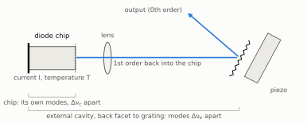
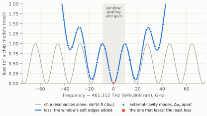
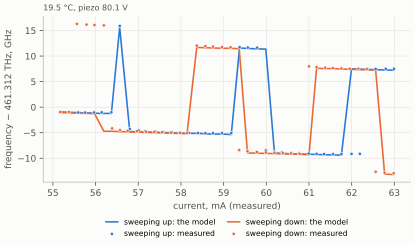
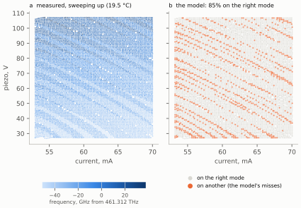

# The laser's physical model

*How SimpleWavemeterLock describes an external-cavity diode laser, fits that description to a laser map, and
uses it to park the laser and to bring it back after a mode hop.*

This page as a PDF: [laser_model.pdf](laser_model.pdf).

The code: `wmlock/lasermodel.py` (the model and its fit), `wmlock/compiled.py` (its inner loops, compiled when
numba is installed), `wmlock/parking.py` (where to park) and `wmlock/modelhop.py` (mode-hop recovery). The
numbers are the lab's two DL pros': the 650 nm laser's temperature map (19 to 20.5 °C, 55,000 points) and the
493 nm laser's first map (4,300 points).

## 1. What it is for

An external-cavity diode laser (ECDL) lases on one mode of its external cavity at a time. Which one depends on
the diode current, the piezo voltage, the diode's temperature, the way the laser came there (sweeping up or
down: hysteresis) and how fast (the chip's temperature lags the current). A wavemeter says which frequency the
laser is on now. It cannot say which mode the laser would take if the current or the piezo were moved.

The model can. Along any path through current, piezo voltage, temperature and time, it gives the mode the laser
is on at every point, and so its frequency. With it the program

* **parks** the laser: it finds the temperature, piezo voltage and current where a mode on the target frequency
  is widest and holds best (`python -m wmlock.lasermap FILE --park NM`);
* **recovers** it after a mode hop: it plans the moves of current and piezo that bring the laser back onto the
  right mode (*Mode-hop recovery…*, method *model*).

## 2. The physics

### 2.1 Three filters

*Figure 1. A Littrow ECDL. The grating's first order goes back into the chip and closes the external cavity;
the zeroth order is the output. The chip's front facet reflects a little, so the chip is a weak cavity of its
own.*

Three things decide where the laser can lase.

* **The external cavity**, from the chip's back facet through the lens to the grating, has modes
  $\Delta\nu_e = c/2L_e$ apart, with $L_e$ its optical length. The piezo pushes the grating and changes that
  length. The current heats the chip and lengthens its part of the cavity. The diode's temperature does both.
* **The chip's own modes.** No anti-reflection coating is perfect, so the chip is itself a weak Fabry-Pérot
  cavity, with modes $\Delta\nu_c = c/2n_gL$ apart. An external mode near a chip resonance loses less light
  than one halfway between two. The current moves the chip's modes several times faster than the external
  modes, so the two combs slide past each other as the current changes. That vernier decides where the laser
  hops.
* **The window.** The grating reflects back into the chip only a band of frequencies, and the gain is only so
  wide: the laser lases only inside that window. The piezo turns the grating as it pushes it, which moves the
  window, though not quite as fast as it moves the external modes.

| | 493 nm laser | 650 nm laser |
|---|---|---|
| external modes apart, $\Delta\nu_e$ | 8.262 GHz (18.1 mm optical) | 3.388 GHz (44.2 mm) |
| chip modes apart, $\Delta\nu_c$ | 87.25 GHz ($n_gL$ 1.72 mm) | 18.35 GHz ($n_gL$ 8.17 mm) |
| external modes to a chip mode | 10.6 | 5.4 |
| current: chip modes, external modes | −4.19, −1.71 GHz/mA | −1.37, −0.25 GHz/mA |
| piezo: external modes, window | +1.37, +0.25 GHz/V | +0.49, +0.67 GHz/V |
| window | 269 GHz | 18 GHz, edges soft over 29 GHz |
| it hops, sweeping the current | every 1.46 mA | every 1.25 mA |

### 2.2 Which mode lases

At every point the model gives each external mode $k$, at frequency $\nu_k$, a loss

$$
g_k \;=\; \sin^2\!\left(\pi\,\frac{\nu_k - m}{\Delta\nu_c}\right)
\;+\; \left(\frac{\max(\nu_k-\nu_{\mathrm{hi}},\,0)+\max(\nu_{\mathrm{lo}}-\nu_k,\,0)}{s}\right)^{2} .
$$

The first term is how far the mode is from the nearest chip resonance ($m$ is where the resonances' centres
are; they repeat every $\Delta\nu_c$). The second is zero inside the window, between $\nu_{\mathrm{lo}}$ and
$\nu_{\mathrm{hi}}$, and grows beyond its edges; $s$ says how softly. A mode $s$ beyond an edge loses as much
more as one halfway between two chip modes does. Soft edges let a chip mode just outside the window take over
where the one inside sits between two external modes, which the 650 nm laser does at its hops.

*Figure 2. The 650 nm laser at 19.47 °C, 81.87 V and 54.7 mA, where it parks for 649.869 nm. Its external modes
(dots) sit on the loss (blue), the chip's resonances (grey) with the window's soft edges added. It lases on
the one with the least loss.*

The laser does not jump to the best mode the moment another becomes best. It stays on its mode until another
one's loss is lower by more than a hysteresis $h$:

$$
\text{it hops to } \arg\min_k g_k \quad \text{if} \quad g_{\mathrm{now}} \;>\; \min_k g_k + h ,
$$

with $h = h_\uparrow$ where the swept axis rises and $h_\downarrow$ where it falls. They are seldom the same:
the 650 nm laser lases on 0.03 GHz past where another mode becomes as good sweeping up, 0.42 GHz sweeping down.

Two more things hold a mode once it lases.

* **The chip's lag.** The chip's temperature follows the current with a time constant $\tau$. Its resonances
  sit where a current $I_w$ lagging behind would put them: from one point to the next,
  $I_w \leftarrow I + (I_w - I)\,e^{-\Delta t/\tau}$.
* **The pull.** The lasing mode moves its chip resonance a fraction $\rho$ of the way towards itself:
  $m = b + \rho\,\delta$, with $b$ the resonance's centre without it and $\delta$ the lasing mode's distance from
  it. With $\rho > 0$ a mode holds itself; with $\rho < 0$ it pushes its resonance away. The light a mode does
  not emit heats the chip, and that is likely what is behind it.

### 2.3 Its terms

Each comb is a line of modes moving together. The external modes are

$$
\nu_k = k\,\Delta\nu_e + e, \qquad
e = p_0 + p_I\,\delta I + p_{II}\,\delta I^2 + p_V\,\delta V + p_{VV}\,\delta V^2 + p_t\,\delta t + p_T\,\delta T
\pm \tfrac{1}{2}\,p_{\mathrm{leg}} ,
$$

$\delta$ meaning from the map's middle ($\delta t$ in units of 10 minutes: the cavity's drift) and $\pm$ the
sweep's direction. The chip's resonances have the same terms, their own coefficients, and the lag:
$b = q_0 + q_I\,\delta I + q_{II}\,\delta I^2 + q_V\,\delta V + q_{VV}\,\delta V^2 + q_T\,\delta T + q_I\,(I_w - I)
+ \text{offset}$. The window's edges move together:
$\nu_{\mathrm{lo,hi}} + w_V\,\delta V + w_I\,\delta I + w_T\,\delta T$.

The temperature enters each linearly. On the 650 nm laser, warming the diode moves its chip modes −26.8 GHz/K
(the chip's index and length), its external modes −7.35 GHz/K (−4.96 of that the chip's share of the cavity,
−2.39 the mount warming with the diode) and its window −1.78 GHz/K. So warming slides the chip modes past the
external modes at 19.5 GHz/K, a chip mode every 0.94 K.

| the rule | what it is | 650 nm laser |
|---|---|---|
| $\nu_{\mathrm{lo}}$, $\nu_{\mathrm{hi}}$ | the window's edges | −9.3, +9.0 GHz |
| $s$ | how soft its edges are | 29 GHz |
| $w_V$, $w_I$, $w_T$ | how the piezo, current and temperature move it | +0.67 GHz/V, −0.37 GHz/mA, −1.78 GHz/K |
| $h_\uparrow$, $h_\downarrow$ | the hysteresis, sweeping up and down | 0.0026, 0.034 (of a chip mode's loss) |
| $\rho$ | the pull | −3 % |
| $\tau$ | the chip's lag | 0.13 s |
| offset | the chip resonances' centre, as it lases | +0.14 GHz |

## 3. Fitting it to a map

### 3.1 The map

A laser map (`wmlock/lasermap.py`, *Laser map…* in the program) sweeps the current up and back down at each
piezo voltage, over the whole range asked, at each temperature if asked, with the feedforward off. At every
point it keeps the frequency the wavemeter reads, the current and piezo voltage as read back, the time, and the
power. A line is swept again at the end, so that a drift of the cavity can be told from everything else.

### 3.2 The combs

These are found first, by linear methods.

1. **The external modes' spacing.** Along a sweep the laser stays on one mode for a while, then hops. With the
   tuning along a mode taken off, the frequencies of a line bunch at whole multiples of the external spacing.
   The spacing at which they bunch most is it. The hops are whole numbers of it too, which tells it apart from
   a spacing too coarse.
2. **The chip modes' spacing.** The larger hops are whole numbers of a larger quantum: the chip's modes.
3. **Their terms, by least squares**, once each point's mode number is known: a line's frequencies are unwrapped
   from line to line, and the comb fitted to them. The line swept again at the end gives the drift.

At several temperatures each temperature's combs are fitted alone first. Whole modes more or less per
temperature step fit equally well, so the temperature's coefficients come from physics: the chip's is the one
nearest what a diode chip's modes do (about −7.5×10⁻⁵ of its frequency per kelvin), the external modes' the
chip's share of the cavity plus no more than an aluminium mount's expansion. Then both combs are fitted over
every temperature at once.

### 3.3 The rule

The rest (the window and how it moves, the hysteresis, the pull, the lag, and the chip comb's spacing and
current tuning again) decides only which mode lases, so it cannot be found by least squares. It is found by
simulation: a candidate rule is run along each sweep from its first point, and scored by how many points it puts
on the mode the laser was on. A differential evolution searches for the best:

1. first the rule that makes what the laser did most likely, a point at a time from the mode it was on at the
   one before (smooth, and every hop counts: it finds where the rule is);
2. then, from there and from a plain guess, the rule that puts most points on the right mode with each sweep
   simulated whole, which is what the model is for. A hysteresis of its own and a mode's pull on its resonance
   both hold a mode, and a search settles on one or the other, so this is done twice, once for each.

The better rule is kept, and the other too if it does nearly as well: the map cannot tell them apart, so a
recovery plans for both. At several temperatures the chip's temperature coefficient is then corrected from where
the laser hops at each.

Before a model is used, it is checked against what a real ECDL can be: an external cavity between 5 mm and
0.5 m, a chip shorter than it, most hops whole numbers of its external modes, and more points on the right mode
than a model that never hops would put there. A map whose frequencies were misread fails, and its model is not
taken.

### 3.4 How well it does

*Figure 3. Part of one line of the 650 nm laser's map: the current swept up (blue) and back down (orange), the
wavemeter's readings (dots) and the model run along the same path (lines). Sweeping down, it hops at lower
currents than sweeping up: its hysteresis, 0.6 mA here.*

*Figure 4. The 650 nm laser at 19.5 °C, sweeping up. (a) The frequency it lased at; each diagonal stripe is a
mode. (b) The model, each sweep simulated from its first point: grey where it put the laser on the mode it was
on, orange where not. Nearly all the misses are along the hops, a point or two early or late.*

On the 650 nm laser the model puts 86 % of the map's points on the right mode (86 to 87 % at each temperature),
against 13 % for a model that never hops. 96 % of the rest are within two points of a hop. On the 493 nm laser's
first map it put 77 % there, 97 % of the rest within two points of a hop. The 493 nm laser is on different modes
sweeping up and down over nearly all of its range; the 650 nm laser over 39 % of it.

## 4. Using it

### 4.1 Where to park it

`python -m wmlock.lasermap FILE --park NM` sweeps the model at rest along the current, up and back down, at every
piezo voltage and every temperature across the map's (in steps of 0.05 K, 0.5 V and 0.05 mA, then finer about
the best). Wherever a mode is on the target frequency and is the same mode sweeping up and down, it is a spot:

* its **core** is how far either way the current can come from and still arrive on that mode;
* **held** is how far, parked on it, the current can move before it hops;
* a **lock** on the piezo takes up so much drift of the cavity before it hops, with the feedforward off, with
  the controller's, and with the ideal one.

The spots are ranked by the narrower side of their core, so the widest mode wins and the spot is in its middle.
A laser with a large hysteresis, like the 493 nm one, has few spots that are the same both ways; for it the
spots on target one way only follow, with the way to come to them (*sweep it DOWN to … mA from … mA or above*).
The output starts with the steps to take: the temperature, the piezo voltage, the current, and the lock.

### 4.2 After a mode hop

A recovery by the model (`wmlock/modelhop.py`) first places the model's external modes where the laser last was
on target, since they drift. It then plans, over every external mode on target near where the laser is, the
moves of current and piezo that arrive on it and hold it, by both rules where two did nearly as well. It runs
the best plan and checks the frequency at each step.

## 5. What a map cannot tell

* **The cavity's drift.** Without a line swept again later, a drift is taken for the piezo's doing. Sweep the
  first line again, sooner or more often.
* **The temperature's coefficients**, between the temperatures mapped. Whole modes more or less per step fit as
  well (on the 650 nm laser's 0.5 K steps: the chip's −63.6 or +9.9 GHz/K, the external modes' −14.1 or
  −0.5 GHz/K). The ones chosen are what a diode and an ECDL do. Map in steps of 0.25 K or less to be sure;
  `--park --robust` ranks every spot by the worst of those.
* **What holds a mode.** A hysteresis of its own and a pull can explain the same map. Both are kept when they do
  nearly as well.

## 6. How long it takes

On the 650 nm map (55,000 points at four temperatures) fitting the model takes about 15 s and parking 3 s on a
four-core PC with numba installed (`pip install numba`): its inner loops are compiled and look only at the modes
that could be chosen. A hop goes only to a mode whose loss is below the lasing one's less the hysteresis, and at
most points there is none. Without numba the same model takes about 2½ minutes. `--save-model` keeps the model
in the map's file, after which `--park` takes seconds.
